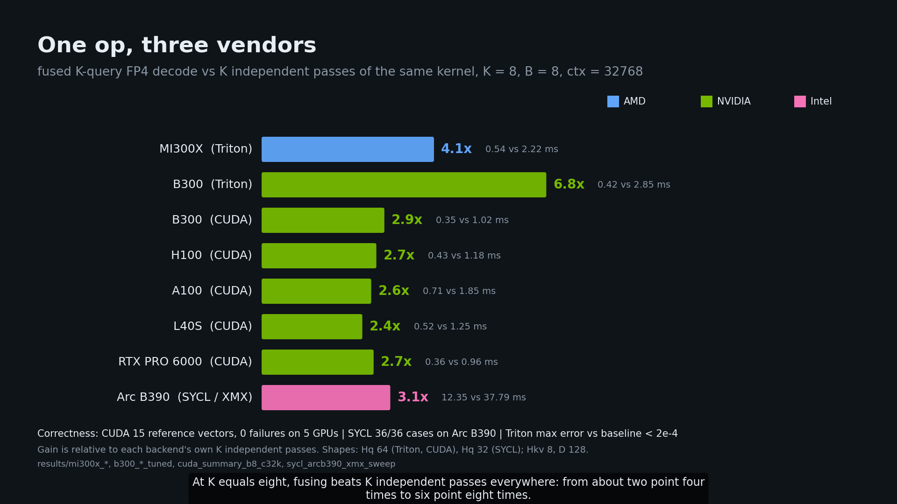

# UltraQuant (uqmt): fused K-query FP4 KV-cache verify attention, on AMD, NVIDIA and Intel

<p align="center"><a href="video/ultraquant_explainer.mp4"></a></p>

This repo implements one operation: **decode / speculative-verify attention over a 4-bit paged KV cache in the UltraQuant format** (FP4 e2m1 values, one UE8M0 power-of-two scale per 32 channels: 68 bytes per head per token for K or V at head_dim 128, **3.76x smaller than fp16, 1.88x smaller than fp8**), where **all K speculative queries and the GQA group share a single pass over the KV pages**.

The same op is ported to **AMD (Triton, MI300X)**, **NVIDIA (native CUDA, `mma.sync`; A100, H100, L40S, B300, RTX PRO 6000)** and **Intel (SYCL / XMX, Arc B390)**. All three consume the same cache layout, are checked against the same CPU reference vectors, and the layout is byte-compatible (a pure permute) with the upstream vLLM/SGLang UltraQuant cache ([cuda/UPSTREAM_COMPAT.md](cuda/UPSTREAM_COMPAT.md)). **Prior art, stated plainly:** the UltraQuant format and a vLLM backend for it already exist upstream (vLLM PR #57057, `--kv-cache-dtype ultraquant_4bit`, merged 2026-10-06; AMD gfx950-oriented, FlyDSL D=256 decode plus a Triton fallback). In the vLLM source we read on 2026-11-12 it is listed for ROCm only, and its decode paths pass `max_query_len=1`, i.e. no K-query read sharing; we did not run it. K-query KV sharing in general is not new either, and on B300 vendor NVFP4 kernels are faster than our port (see "Where we stand"). In the public sources we checked we found no CUDA or SYCL implementation of the UltraQuant layout with fused K-query verify ([cuda/PRIOR_ART.md](cuda/PRIOR_ART.md), [sycl/PRIOR_ART.md](sycl/PRIOR_ART.md); the search was not exhaustive).

**Headline numbers** (measured; one attention layer, batch 8, context 32768, Hq64/Hkv8/D128, page 64, synthetic KV):

| | MI300X (Triton) | B300 (CUDA) | H100 (CUDA) |
|---|---|---|---|
| K=1 decode | 0.36 ms | 0.139 ms | 0.163 ms |
| K=8 verify, fused | 0.54 ms | 0.307 ms | 0.215 ms |
| K=8 fused vs K independent launches | 4.1x | 3.3x (CUDA), 6.8x (Triton) | 5.6x |

On real Mistral-7B on MI300X the fused kernel is **1.0-1.75x faster than the best fp16 attention per call** (typically 1.3-1.6x) while reading 3.76x fewer bytes, and a whole decode step is **1.3-1.6x faster at batch 8 / 16k-32k context with K=8** (MI300X; on H100 with the CUDA port 1.52x at K=1 and 2.15x at K=8, B=8 / 32k), but **about 1.0x at batch 1** on MI300X. The robust win is memory: **3.76x more KV tokens per GB**.

```
 plain decode of K speculative tokens          UltraQuant fused K-query
 q0 -> [read all KV pages] -> o0               q0 \
 q1 -> [read all KV pages] -> o1                q1  |  one tile: M = K x GQA group
 ...                                            ... |-> [read each KV page ONCE] -> o0..oK-1
 qK-1 -> [read all KV pages] -> oK-1            qK-1/    (FP4 -> bf16 in registers, per-query
 HBM traffic: K x KV                                      causal mask, split-KV + LSE reduce)
                                                HBM traffic: 1 x KV
```

## Install and use (Triton reference, `uqmt`)

```bash
pip install git+https://github.com/Bobliuuu/ultraquant-more   # or: pip install -e .
```

Importing needs only PyTorch (quantise / dequantise / reference / cache builder run on CPU); the kernel needs a GPU and Triton (ROCm 7 + Triton 3.9 and B300 tested). CUDA and SYCL builds: [cuda/README.md](cuda/README.md), [sycl/README.md](sycl/README.md).

```python
import torch, uqmt

k = torch.randn(8, 8, 4096, 128, device="cuda"); v = torch.randn_like(k)      # dense [B, Hkv, T, D]
cache = uqmt.build_paged_cache(k, v, page_size=64, seq_lens=[4096] * 8)      # paged FP4 + page table

q = torch.randn(8, 4, 64, 128, device="cuda", dtype=torch.bfloat16)          # [B, K, Hq, D], K = 1 + spec tokens
out = cache.decode(q)            # seq_lens includes the K new tokens; nsplit chosen automatically

ws = uqmt.UQWorkspace.create(8, 4, 64, 8, 128, nsplit=uqmt.auto_nsplit(8, 8, 64))   # CUDA-graph friendly
out = uqmt.uq_decode(q, cache.kc, cache.ks, cache.vc, cache.vs,
                     cache.block_table, cache.seq_lens, workspace=ws)
ref = uqmt.reference(q, cache.kc, cache.ks, cache.vc, cache.vs, cache.block_table, cache.seq_lens)
```

Public API: `uq_decode`, `quantize_fp4`, `dequantize_fp4`, `reference`, `build_paged_cache` / `PagedFP4Cache`, `UQWorkspace`, `auto_nsplit`, `uqmt.vllm_adapter` (varlen verify wrapper, cache-append hook), plus `uqmt.quant` (paper scale rule, Hadamard, NVFP4 quantiser variants), `uqmt.tree` (tree-masked verify for EAGLE/Medusa-style trees) and `uqmt.nvfp4` (NVFP4 scale path, below).

Layout (uint8): `kc, vc [pages, Hkv, PAGE, D/2]` (low nibble = even element), `ks, vs [pages, Hkv, PAGE, D/32]` (UE8M0, value 2^(s-127)). Query token j of K attends to `seq_len - K + j + 1` positions; rows with nothing visible return zeros.

**Supported:** head_dim 64/128; any GQA ratio (tested 1,2,4,7,8,16); K 1-16; page 16/32/64/128; ragged, empty and shorter-than-K sequences; int32/int64 block tables; bf16 queries. `nsplit` is auto-selected (about 4 programs per compute unit, rounded down to a power of two, clamped to the page count); override with `nsplit=`.

## Three vendors, one op

Single layer, B=8, ctx=32768, Hq64/Hkv8/D128, page 64, best tuned config per K, random data. Sources: `results/mi300x_b8_c32k_tuned.json`, `results/cuda_summary_b8_c32k.json`, `results/b300_b8_c32k_tuned.json`.

| GPU / backend | K=1 ms | K=2 | K=4 | K=8 | FP4 GB/s at K=1 (% of measured HBM copy) |
|---|---|---|---|---|---|
| **MI300X**, Triton (HBM copy 3.9 TB/s) | 0.361 | 0.373 | 0.453 | 0.542 | 789 (20%) |
| **B300**, CUDA (6.57 TB/s) | 0.139 | 0.142 | 0.255 | 0.307 | 2055 (31%) |
| B300, Triton | 0.308 | 0.310 | 0.425 | 0.494 | 925 |
| **H100**, CUDA (3.03 TB/s) | 0.163 | 0.164 | 0.215 | 0.215 | 1747 (58%) |
| **A100 80GB SXM**, CUDA (1.75 TB/s) | 0.256 | 0.266 | 0.465 | 0.713 | 1113 (64%) |
| **L40S**, CUDA | 0.391 | 0.395 | 0.431 | 0.494 | 729 |
| **RTX PRO 6000**, CUDA | 0.208 | 0.210 | 0.288 | 0.381 | 1375 (94%) |

Fused versus the same kernel run K times (CUDA, same GPU), K=2 / 4 / 8: H100 2.0x / 2.9x / 5.6x, B300 2.05x / 2.1x / 3.3x, A100 2.0x / 2.1x / 2.6x, RTX PRO 6000 1.45x / 1.9x / 2.7x, L40S 1.1x / 1.55x / 2.5x; MI300X Triton 1.83x / 2.59x / 4.10x; B300 Triton 1.79x / 2.82x / 6.77x. K=1 gains nothing from fusion, as expected. The H100 K>=4 rows use the sm_90a wgmma variant, the B300 K=8 row the tcgen05 variant (1.14x over the `mma.sync` kernel; the rest of the B300 rows are unchanged `mma.sync` kernels). CUDA numbers are `results/cuda2_summary.json`; `copy_` underreports GDDR read bandwidth, so L40S percentages are not meaningful.

**Intel Arc B390 (SYCL; ESIMD/DPAS path, XMX `joint_matrix` path)**, Hq32/Hkv8/D128, B8, 16k context, ms per layer call (`results/sycl2_summary.json`, baselines `results/sycl2_baselines_*.json`):

| K | UltraQuant ESIMD | UltraQuant XMX (earlier) | torch-XPU f16 SDPA | IPEX paged f16 | llama.cpp q4_0 KV |
|---|---|---|---|---|---|
| 1 | **1.72** | 2.62 | 4.90 | 4.99 | 2.03 |
| 4 | **1.77** | 3.49 | 5.87 | 10.03 | 2.29 |
| 8 | **3.47** | 7.24 | 5.81 | 10.06 | 3.88 |

The ESIMD path is 1.4x to 2.2x faster than the earlier XMX path. Against the baselines on this part: ahead of torch-XPU and IPEX f16 attention while reading 3.8x fewer bytes, roughly level with llama.cpp's integer q4_0 KV at K=1 (2.03 vs 1.72 ms), and ahead of it at K>=4 (llama.cpp is non-paged integer 4-bit, not the UltraQuant format). The measured random-data read ceiling of this GPU is about 105-113 GB/s (uniform data reads 2.5-4x faster because of compression and is not a valid peak): ESIMD reaches ~75% of it at K=1 and K=4 and ~38% at K=8; the earlier XMX path ~50% at K=1. FP4 is decoded in software; XMX has no fp4.

**Correctness:** CUDA passes the 15 CPU reference vectors in every launchable config on all five NVIDIA GPUs (1260-1856 launches each, `results/cuda_*_vectors_check.log`); error vs the fp32 reference at the benchmark shape is 1.1e-4 to 1.5e-4. SYCL passes 36/36 vectors per path on Arc B390 (UE8M0; NVFP4 10/10), and also on CPU (OpenCL), A100 and H100. The CUDA NVFP4 path passes its own vectors (2016 launches on H100) and the cuda2 harness has 0 failures on all five GPUs (`results/cuda2_*_vectors*.log`). The Triton kernel passes 50 pytest cases on MI300X (ragged lengths, head_dim 64/128, GQA 1-16, K up to 16, pages 16-128, negative-zero codes, scale extremes, CUDA/HIP-graph replay); `tests/` run on CPU without a GPU, GPU tests skip cleanly.

## Where we stand

| Comparison | Result |
|---|---|
| MI300X, real Mistral-7B shapes: ours vs best fp16 attention (cold cache) | 1.0-1.75x faster per call (parity at B=32 / 4k / K=8); vs torch SDPA 3.3-18x at B<=8 (SDPA is a weak baseline there) |
| MI300X, K=8, B8 / 32k: ours vs K calls of amd-experiments' TQ3 kernel | 0.48 ms vs 8.5 ms (their kernel is K=1 only) |
| B300, K=1/2/4/8: ours CUDA | 0.139 / 0.142 / 0.255 / 0.307 ms |
| B300: **FlashInfer trtllm-gen NVFP4** (fp8 q, NVFP4 E4M3/16 scales, tcgen05) | **0.066 / 0.077 / 0.097 / 0.094 ms, 2.1x (K=1) to 3.3x (K=8) faster than our port**, and it already does fused K-query verify |
| B300: BitDecoding-FP4 (single-query; K independent decodes) | 0.068 / 0.131 / 0.261 / 0.521 ms |
| B300: FlashInfer trtllm-gen fp8 KV, fp8 q (2x the bytes) | 0.080 / 0.081 / 0.083 / 0.087 ms |
| vLLM upstream UltraQuant backend (PR #57057) | exists since 2026-10-06; ROCm-listed, single-query decode paths in the source we read; not run by us, no timing comparison |
| Arc B390: ours (ESIMD) vs torch-XPU f16 SDPA / IPEX / llama.cpp q4_0 | B8/16k K=1/4/8: 1.72 / 1.77 / 3.47 ms vs 4.90 / 5.87 / 5.81 / 4.99-10.1 / 2.03 / 2.29 / 3.88 (llama.cpp competitive at K=1, ours ahead at K>=4) |

So: **we do not beat vendor-tuned NVFP4 kernels on B300**, and fused FP4 K-query verify exists there already (FlashInfer). What this repo offers is the exact UltraQuant format (UE8M0 per 32, bf16 queries, any page size, ragged lengths and causal verify masks), K-query sharing, and one validated implementation across AMD, NVIDIA and Intel. The CUDA port is 1.1x to 2.8x faster than our Triton kernel on every NVIDIA GPU measured (H100 2.1-2.3x, B300 1.6-2.2x).

## Accuracy: how the quantisers compare

Quantise-on-write / dequantise-on-read through a real HF cache path on Mistral-7B-v0.1 and Qwen3-8B (wikitext-2 perplexity; full table with C4, needle, multi-key, KV-retrieval and spec-acceptance columns in [results/quality_summary.md](results/quality_summary.md)). `official` = repo code, `official-port` = the amd-experiments kernels run unchanged, `simulated` = our quantise-dequantise reimplementation of the published scheme. Single run per cell, small samples.

| method | kind | B/vec | Mistral dppl | Qwen3-8B dppl | Qwen3 attn cos |
|---|---|---|---|---|---|
| fp16 | reference | 256 | 4.873 (ppl) | 8.522 (ppl) | 1.000 |
| fp8 e4m3 | simulated | 128 | +0.008 | +0.007 | 0.996 |
| KIVI-4 | simulated | 80 | +0.007 | +0.025 | 0.998 |
| KVQuant-4 | simulated | 85 | +0.041 | -0.007 | 0.982 |
| **NVFP4 (E4M3/16)** | simulated, kernel-checked | 72 | +0.052 | +0.103 | 0.980 |
| **UltraQuant FP4/UE8M0 (this repo)** | official | 68 | +0.139 | +0.562 | 0.932 |
| UltraQuant + paper scale rule (c=0.156) | simulated | 68 | +0.310 (no rotation) | +0.929 (no rotation) | 0.894 |
| UltraQuant-style + Hadamard on K | simulated | 68 | +0.035 | +0.521 | 0.964 |
| MXFP4 | simulated | 68 | +0.190 | +0.481 | 0.923 |
| TurboQuant 4-bit | official-port | 68 | +0.026 | +0.581 | 0.979 |
| TurboQuant 3-bit | official-port | 52 | +0.142 | +1.995 | 0.933 |
| Planar / Iso / Rotor 3-bit | official-port | 52 | +6.1 / +2.5 / n/a | +16.7 / +13.9 / +13.4 | 0.70-0.72 |

Reading: FP8 and KIVI/KVQuant at 4-5 bits are the accuracy leaders; plain 68-byte FP4 costs 0.14 ppl on Mistral and 0.56 on Qwen3-8B, and **NVFP4 (+4 bytes per vector) cuts that penalty about 9x on Qwen3-8B (through the kernel: +0.06 vs +0.55 for MXFP4; 5x in the table's fake-quant column) and 2.7x on Mistral**, at ~1-2% more kernel time. The paper's constant c = 0.156 did not transfer to these two models; our scale rule equals the paper's `round(log2(c*amax))` at c = 0.236 ([docs/SCALE_RULE.md](docs/SCALE_RULE.md)). Speculative acceptance drops with 4-bit KV (Qwen3-8B accept@8 0.265 FP4 vs 0.985 fp16 in the quality harness; 0.46 NVFP4), which offsets part of the per-step gain, so quality and acceptance must be validated per model.

**Recommendation:** for new deployments where 72 vs 68 bytes does not matter, use the **NVFP4 scale path** (`uqmt.nvfp4`: E4M3 scale per 16 elements plus a per-layer fp32 tensor scale, integer-only scale decode, identical on AMD and NVIDIA). Keep UE8M0/32 when bit-compatibility with upstream UltraQuant caches is required.

## Real-model whole-step results (MI300X, Mistral-7B-v0.1)

Hand-rolled decode loop over the HF modules so only the attention backend changes; real prefill KV; GPU kernel time summed from the profiler ("graph-mode" projection, because the eager loop is launch-bound). Full tables: [results/e2e_summary.md](results/e2e_summary.md), kernel head-to-head [results/h2h_summary.md](results/h2h_summary.md), real-KV accuracy [results/real_kv_summary.md](results/real_kv_summary.md), overview [results/OVERNIGHT_REPORT.md](results/OVERNIGHT_REPORT.md).

Whole-step speedup of fused FP4 vs the best fp16 attention (higher is better):

| B, ctx | K=1 | K=2 | K=4 | K=8 |
|---|---|---|---|---|
| 1, 8k | 0.97x | 1.10x | 1.10x | 1.13x |
| 1, 32k | 0.97x | 1.11x | 1.14x | 1.15x |
| 8, 8k | 1.08x | 1.21x | 1.24x | 1.29x |
| 8, 16k | 1.07x | 1.24x | 1.33x | 1.41x |
| 8, 32k | 1.13x | 1.29x | 1.46x | **1.60x** |

**Amdahl framing:** attention is 4-17% of the step at batch 1 and 27-57% at batch 8 (8k to 32k context), so the whole-step gain is bounded; even free attention would give only 2.4x at B=8 / 32k. At batch 1 expect no gain (0.96-1.15x). The value is (1) **3.76x KV capacity** (B=8 / 32k: 34.4 GB of fp16 KV becomes 9.1 GB), which is what lets a memory-bound server hold longer contexts or bigger batches, and (2) 1.3-1.6x on **large-batch, long-context speculative verify**. On a real 3-turn agent-like run at B=1 the lower draft acceptance under FP4 KV cancelled the per-step gain (projected 440 vs 460 tok/s). Attention-output cosine on real Mistral K/V is 0.975 for FP4/UE8M0, equal to TurboQuant-3 (0.975), with perplexity +3.0% vs +2.7% on 4k windows.

**Same step on H100 with the CUDA port** (Mistral-7B, B=8, ctx 32768, eager HF-module loop, CUDA-graph replay time; fp16 baseline = torch SDPA, the faster of the two fp16 formulations there; `results/cuda2_e2e_mistral7b_h100_b8_c32k.json`): K=1 14.4 ms vs 22.0 ms (**1.52x**), K=8 16.2 ms vs 34.8 ms (**2.15x**); K=8 with the same kernel run K times is 50.4 ms, so K-query sharing is worth 3.1x at the step level. (B300 ratios from the same harness are not quoted: the fp16 SDPA of that torch build is unusually slow and flatters us.)

### Serving-level evaluation: status

[bench/realworld/](bench/realworld/) holds an agent / RAG / needle / speculative-decoding / greedy-drift harness for vLLM. **No UltraQuant FP4 serving number exists yet**: the MI300X was unreachable during the serving runs, so FP4 serving on MI300X is pending. What was run (Modal H100, stock vLLM, Mistral-7B and Qwen3-8B) is a **proxy with fp8 KV (2x smaller) vs bf16 KV, not FP4 and not UltraQuant**: KV capacity doubles exactly; a 48-session 24k-token agent trace did not gain throughput (prefill/queue-bound); HotpotQA-in-noise F1 was unchanged (0.236 vs 0.234); n-gram speculative decoding at concurrency 32 was 25% faster with fp8 KV at K=4; and fp8 KV changed greedy output early (median first divergence at token 30 versus 513 for a bf16 rerun). These show what a smaller KV changes in serving, nothing about 4-bit accuracy. Details and caveats: [results/realworld_summary.md](results/realworld_summary.md). vLLM 0.33 ships its own native UltraQuant backend with a different cache layout; testing that backend on MI300X is the planned FP4 serving run.

## Porting effort

Porting the op to a new vendor took hours, versus about two weeks for TurboQuant-on-AMD: the CUDA port took about 2.5 hours of agent time (~1.5 kLOC) and SYCL a similar overnight session, against 15 commits over two weeks, a HIP library, a 1,834-line Triton file and custom HSACO/MFMA loaders for amd-experiments ([cuda/PORTING_LOG.md](cuda/PORTING_LOG.md), [sycl/PORTING_LOG.md](sycl/PORTING_LOG.md)). Not like-for-like: TurboQuant also needs rotations, Lloyd-Max codebooks and bit-plane packing, and the UltraQuant ports are one op without engine integration. Both end up ALU/latency-bound for the same reason: decoding sub-byte KV costs more issue slots than its bytes cost in memory time at decode sizes.

## Integration


## Related work and further reading

[docs/RELATED_WORK.md](docs/RELATED_WORK.md) (UltraQuant paper and AMD blog, KIVI, KVQuant, QServe, TurboQuant, NVFP4/MXFP4, FlashInfer, with verification status), [docs/methods.json](docs/methods.json), [docs/USE_CASES.md](docs/USE_CASES.md), [docs/GAPS.md](docs/GAPS.md), [docs/EXPLAINER.md](docs/EXPLAINER.md). The AMD blog names a fused K-query UltraQuant kernel as an open opportunity; this repo supplies one.

## Video

[3.9-minute explainer](video/ultraquant_explainer.mp4) (subtitles in [video/ultraquant_explainer.srt](video/ultraquant_explainer.srt)).

## Reproduce

```bash
pip install -e . pytest && pytest tests -q                  # CPU tests always; GPU tests need a GPU
cd uqmt && python bench.py --batch 8 --ctx 32768 --ks 1 2 4 8 --nsplit 16 --check   # Triton, fused vs K independent
UQ_WARPS=8 UQ_STAGES=3 python bench.py --batch 8 --ctx 32768 --ks 8                  # B300 K=8 config
python peak.py peak.json                                    # device ceilings
cmake -S cuda -B build && cmake --build build -j && ./build/test_vectors cuda/vectors 1e-2   # CUDA vs reference vectors
```

Tuning notes: `results/mi300x_tuning_notes.md`, `results/b300_tuning_notes.md`, `results/cuda_tuning_notes.md`, `results/sycl_tuning_notes.md`. Best Triton configs: MI300X `UQ_WARPS=2 UQ_STAGES=2 nsplit=16`; B300 K=1 `4/3/64`, K=8 `8/3/16`.

## Limitations

* **Software FP4 dequant on gfx942 and Intel Arc.** MI300X has no FP4 or scaled-FP4 MFMA and Arc's XMX has no fp4; e2m1 is decoded in registers (on Arc the ESIMD kernel reaches about 75% of the measured random-data read ceiling at K=1 and 38% at K=8). The kernel reaches only **4-26% of MI300X HBM peak** (20% at K=1 B8/32k), so most of the 3.76x byte saving is not converted into time. Native scaled MFMA needs gfx950 (MI350/MI355X); not measured here.
* **No native block-scaled FP4 MMA path on NVIDIA** (`mma.sync` block-scale on sm_120 and CUTLASS tcgen05 block-scaled QK on B300 were studied, not fused). The B300 K=8 kernel uses a bf16 tcgen05 variant (only 1.14x over `mma.sync`) and is still 3.3x slower than FlashInfer's NVFP4 kernel; vendor NVFP4 kernels are faster there.
* **Mostly synthetic and microbenchmark data.** Real-model numbers cover Mistral-7B-v0.1 (kernel/whole-step, MI300X) and Mistral-7B / Qwen3-8B (accuracy); perplexity and cosine come from single runs on small samples (8 to 16 windows); task accuracy (SWE-bench-style, RULER) is not measured. Many methods in the accuracy table are our own simulations of the published schemes.
* The whole-step results are a decode loop of our own over HF modules, not a served vLLM run; wall-clock steps are launch-bound, so tokens/s are projections from GPU kernel time. Draft acceptance was measured only at B=1 with a prompt-lookup drafter.
* SemKV and StarKV were not benchmarked (no public code found).
* K=1 gains nothing from fusion. The fp8-MFMA score path (`UQ_FP8K=1`) is experimental, head_dim 128 only, and slower on MI300X.

## What we tried

An fp8-MFMA K-score path and a scale-broadcast variant; neither beat the default bf16 path on MI300X.
