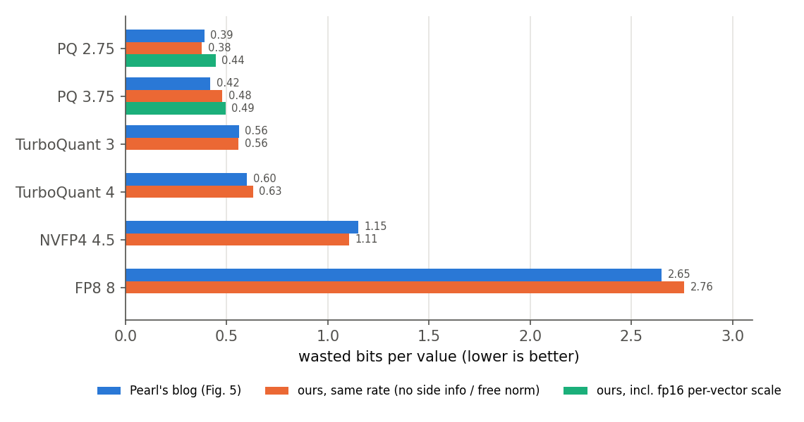
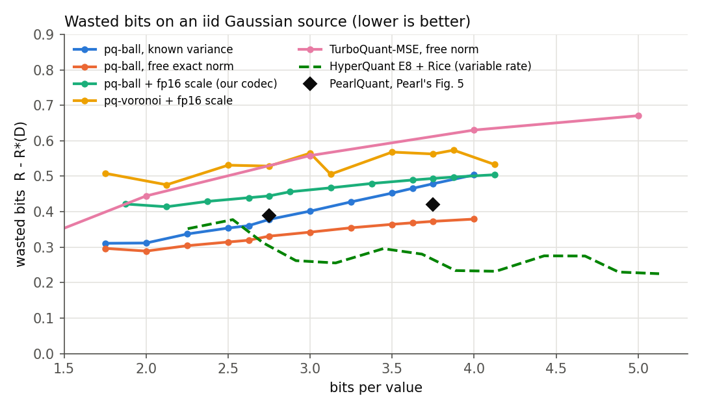

# pq-repro: a PearlQuant-style E8 KV-cache codec, reproduced from public information

Pearl Research Labs described **PearlQuant**, an E8-lattice KV-cache quantizer with a fused
Blackwell decode-attention kernel, in a blog post
(https://pearlresearch.ai/research/blog/pearlquant). They released no code and no format.
This repo is an independent reconstruction: **pq-repro**, a PearlQuant-*style* codec. It is
not Pearl's code, it runs a different model, and every gap in their description was filled by
a choice of ours, listed in [DESIGN.md](DESIGN.md).

What is here:

1. `pqrepro/`: the codec (random Hadamard rotation, fp16 per-vector scale, E8 "probable
   points" ball codebook with leader indexing; NestQuant-style Voronoi codebook as an ablation),
   plus scalar baselines (FP8, NVFP4, int4, a TurboQuant-MSE re-implementation).
2. `experiments/rd_gaussian.py`: Pearl's "wasted bits" rate-distortion comparison on an iid Gaussian.
3. `experiments/kl_pg19.py`, `experiments/niah.py`: KL divergence from an FP8 KV cache on PG-19
   (Pearl's metric) and a small needle-in-a-haystack check, on Qwen3-8B.
4. `kernels/`: fused split-KV decode attention that reads the compressed cache and decodes
   codewords on chip, in CUDA, HIP (same source) and SYCL, checked on shared test vectors on
   H100, MI300X, Arc B390, plus SYCL on H100 (CUDA backend) and a Xeon CPU.

All numbers below are generated from files in `results/` by `tools/summarize.py`
(full tables: [results/SUMMARY.md](results/SUMMARY.md)).

## What Pearl disclosed and what we chose

| | Pearl (blog) | pq-repro (ours) |
|---|---|---|
| lattice, group | E8, groups of 8, "NestQuant inspired" | same |
| rotation | "a random rotation" | random signs + Walsh-Hadamard per 128-dim head vector |
| codebook | "only assign indices to probable lattice points under the Gaussian i.i.d. distribution" | the 2^b smallest-norm E8 points; index = leader offset + permutation rank + sign bits |
| scale | not disclosed | one fp16 per vector (+0.125 bpv), best of 8 gains |
| rates | 3.2 / 2.3 / 2.1 bpv model averages (NoPE/RoPE split not disclosed) | K/V bits per group 25/24, 18/17, 16/16 -> 3.19, 2.31, 2.125 bpv incl. scales |
| outliers | not disclosed | optional K mean-centering (`-kc`), exactly softmax-invariant, free in the kernel |
| model | GLM-5.3 (MLA/DSA), 8xB200 | Qwen3-8B (GQA, head_dim 128), one GPU |
| kernel | CuTe DSL, Blackwell tensor cores | portable CUDA/HIP/SYCL, CUDA-core FMAs, no tensor cores |

## 1. Rate-distortion (iid Gaussian)



The shape of Pearl's Fig. 5 reproduces: the E8 ball codebook wastes 0.38 bits per value at
2.75 bpv (Pearl: 0.39) and 0.48 at 3.75 bpv (Pearl: 0.42) when no side information is counted,
against 0.56 / 0.63 for TurboQuant-MSE at 3 / 4 bits (Pearl: 0.56 / 0.60), 1.11 for NVFP4
(1.15) and 2.76 for FP8 (2.65). With a free exact per-vector norm (TurboQuant's accounting) the
ball code wastes 0.33 / 0.37; with our stored fp16 scale counted, 0.44 / 0.49. We do not know
which accounting Pearl used. The Voronoi (NestQuant) codebook is 0.05 to 0.1 bits worse at
equal rate, and HyperQuant's entropy-coded E8 (variable rate, not randomly accessible) beats
every fixed-rate code here (0.30 / 0.26).



## 2. Model quality (Qwen3-8B, not GLM-5.3)

KL divergence of next-token distributions from an FP8 KV cache (e4m3, fp32 scale per
128-value vector), PG-19 test books, 4 books x 16,384 tokens, Qwen3-8B. Our KV cache
is quantized at write time (K after RoPE), so every query sees the decoded cache, as in a real
decode step. `-kc` adds our K mean-centering.

| config | bits/value | KL from FP8 | PPL (FP8: 16.95) | Pearl's KL on GLM-5.3 |
|---|---|---|---|---|
| bf16 | 16 | 0.008 | 16.88 | |
| NVFP4 | 4.5 | 0.055 | 17.47 | |
| int4, fp16 scale / 32 | 4.5 | 0.118 | 18.21 | |
| TurboQuant-MSE 3 b + K-centering | 3.125 | 0.150 | 18.52 | |
| **pq-repro 3.2** (K 25 / V 24 bits per 8) | 3.19 | 0.223 | 19.43 | 0.057 |
| **pq-repro 3.2 + K-centering** | 3.19 | **0.098** | 17.93 | 0.057 |
| **pq-repro 2.3 + K-centering** | 2.31 | **0.264** | 20.10 | 0.122 |
| **pq-repro 2.1 + K-centering** | 2.125 | **0.440** | 23.14 | 0.207 |
| pq-repro 2.3 / 2.1, no centering | 2.31 / 2.125 | 1.62 / 1.92 | 70 / 92 | |
| TurboQuant-MSE 3 b / 2 b, no centering | 3.125 / 2.125 | 1.09 / 2.42 | 42 / 143 | |

Read with care:
- The ordering matches Pearl's (KL grows steadily as the rate drops), and at about 3.2 bpv the
  E8 codec beats a scalar Lloyd-Max codec at 3.125 bpv (0.098 vs 0.150). In absolute terms our
  KL is about 2x Pearl's at every rate, on a different model (GQA, no MLA latent, Qwen3's
  large-norm layer-0 keys) with our own guesses for every undisclosed choice.
- Without K mean-centering, Qwen3-8B's keys (large shared component, especially in layer 0)
  break every low-bit rotated codec at long context: KL > 1 at 2.3 bpv. Centering is exact for
  attention (each query's logits shift by one constant), costs nothing in the kernel, and
  fixes most of it. Pearl does not say whether they do anything like this.
- Centering V as well (`-kvc`) did not help (0.104 / 0.330 / 0.525).
- Full table, per-book values, Voronoi ablation and the K/V bit-split ablation:
  [results/SUMMARY.md](results/SUMMARY.md).

NIAH_PLACEHOLDER

## 3. Kernels

One source for CUDA and HIP (`kernels/cuda/pq_attn.cuh`), one SYCL port
(`kernels/sycl/pq_sycl.cpp`), one decoder header shared by all three
(`kernels/common/pq_ball_decode.h`). Split-KV flash decoding; per 32-token tile the block
copies the packed codes to shared memory, each thread decodes groups of 8 (leader lookup,
branch-free multiset-permutation unrank, signs) into exact int8 lattice coordinates, and the
query (rotated once per call) is dotted against them; V is accumulated in the rotated domain
and un-rotated once in the reduce kernel. A cached vector costs exactly 2·b + 2 bytes.

**Correctness**: 96/96 checks (8 cases x {pq, bf16, fp8} x 4 split counts, relative L2 error
< 1e-4 against float64 attention over the decoded cache; worst pq error 1.1e-6) on
CUDA/H100, CUDA/B200, HIP/MI300X, SYCL/Arc B390 (Intel GPU), SYCL via the DPC++ CUDA backend
on H100, and SYCL on a Xeon CPU (OpenCL).

**Speed** (B=8, 32k context, Qwen3-8B-like GQA: Hq=32, Hkv=8, D=128, pq at 3.19 bpv, us per call):

| GPU / backend | pq-repro | bf16, same kernel skeleton | fp8, same skeleton | vendor bf16 |
|---|---|---|---|---|
| MI300X / HIP | 1412 | 955 | 1246 | not measured |
| H100 / CUDA | 1862 | 536 | 1070 | 360 (torch SDPA) |
| B200 / CUDA (same source, no tensor cores) | 1672 | 522 | 1062 | 221 (torch SDPA) |
| H100 / SYCL (DPC++ CUDA backend) | 2165 | 665 | 2456 | |
| Arc B390 / SYCL (B=4) | 10098 | 6085 | 7408 | not measured |

The pq cache is 5.0x smaller than bf16 (102 vs 512 bytes per token and KV head), but the
kernel is **slower** than bf16 everywhere: it is bound by codeword decode (integer ALU), not
by memory. At GQA-4 each decoded group serves only 4 query heads; Pearl's GLM-5.3 uses MLA,
where one decoded latent serves every head, and their kernel feeds tensor cores. We did not
reach their "about as fast as NVFP4" result. The optimization history (6.7 ms -> 1.41 ms on
MI300X, mostly occupancy) is in [kernels/PORTING_LOG.md](kernels/PORTING_LOG.md).

## Reproduce

```
python tests/test_codec.py                                    # codec self-checks (CPU)
python experiments/rd_gaussian.py --out results/rd_gaussian.json
python tools/plot_rd.py
modal run experiments/modal_quality.py --task kl --args "--nseq 4 --ctx 16384 --configs fp8,pq-3.2-kc --out /out/x.json"
python tools/gen_vectors.py kernels/vectors                   # shared test vectors + leader tables
nvcc  -O3 -std=c++17 -arch=sm_90a kernels/cuda/pq_bench.cu -o pq_bench     # or:
hipcc -O3 -std=c++17 --offload-arch=gfx942 kernels/cuda/pq_bench.cu -o pq_bench
./pq_bench check kernels/vectors
./pq_bench bench kernels/vectors/tables 8 32768 32 8 25 24
clang++ -fsycl -O3 -std=c++17 kernels/sycl/pq_sycl.cpp -o pq_sycl && ./pq_sycl check kernels/vectors
python tools/summarize.py
```

## Limitations

- Different model and attention type than Pearl (GQA vs MLA), so absolute KL values are not
  comparable; the per-component rate split is ours.
- KL uses 4 PG-19 books x 16k tokens; NIAH is our own small generator, not RULER.
- The kernels are correct on every backend we ran but are not fast: decode is ALU-bound at
  GQA-4 and our kernels do not use tensor cores. See [kernels/PORTING_LOG.md](kernels/PORTING_LOG.md).
- No paged KV and no vLLM integration; serving results (TTFT, throughput) were not attempted.
