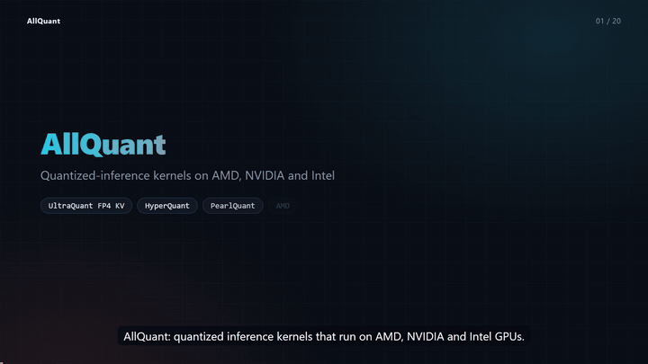
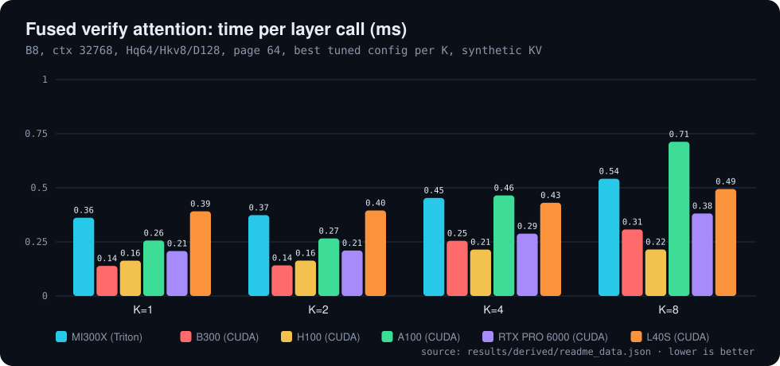
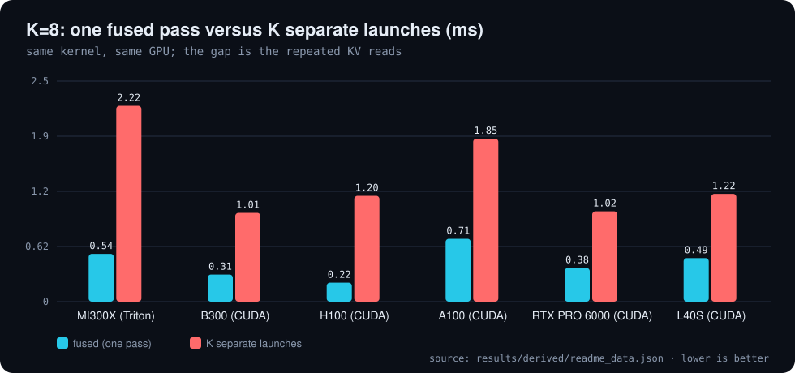
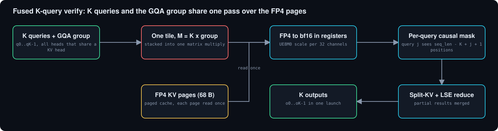
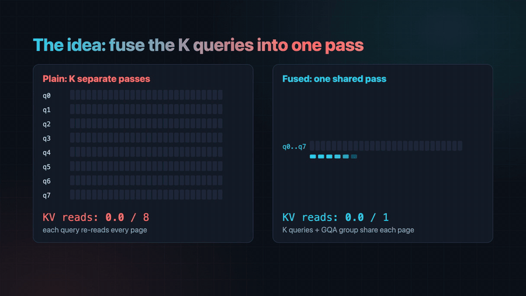
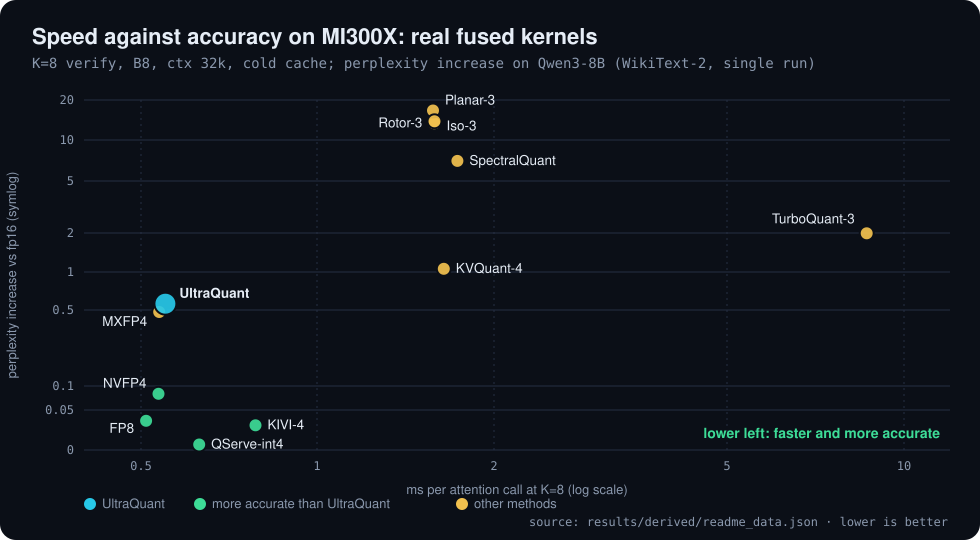
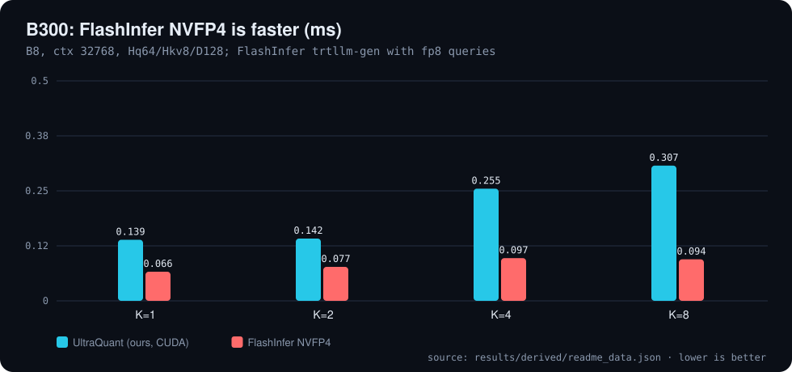
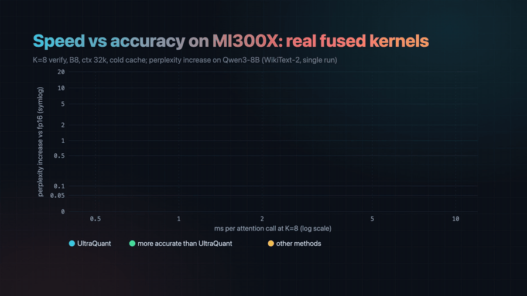
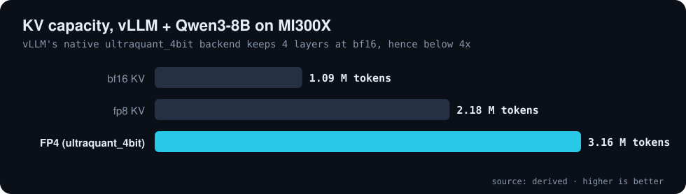

<div align="center">



# ⚡ AllQuant

**Quantized-inference kernels on AMD, NVIDIA and Intel GPUs: a fused FP4 KV-cache verify kernel, plus reproductions and three-vendor ports of HyperQuant, UltraQuant, and PearlQuant**

     [](LICENSE) 

[🎬 Video](#video) · [📊 Results](#results) · [🔁 Ports](#ports) · [🧩 How it works](#how-it-works) · [🖥️ Three vendors](#three-vendors) · [⚖️ Where we stand](#where-we-stand) · [🧠 Serving](#serving) · [🚀 Install](#install) · [🔁 Reproduce](#reproduce) · [⚠️ Limitations](#caveats) · [🗺️ Repo map](#repo-map)

</div>

---

**Explainer video (with voice-over and subtitles): the problem, the idea, the numbers, and where each model does not win**

[](video/ultraquant_explainer.mp4)

<a id="video"></a>
This repo collects quantized-inference kernels that run on all three GPU vendors, each checked against one CPU reference:
the original **UltraQuant FP4 KV-cache verify kernel** (below), and **reproductions plus CUDA → HIP/SYCL ports of recent quantization papers**
under [`ports/`](ports) ([HyperQuant](ports/hyperquant) and [PearlQuant](ports/pearlquant)). See [Ports](#ports).

The core kernel implements one operation: **decode / speculative-verify attention over a 4-bit paged KV cache in the UltraQuant format**
(FP4 e2m1 values, one UE8M0 power-of-two scale per 32 channels: 68 bytes per head per token for K or V at head_dim 128,
**3.76x smaller than fp16, 1.88x smaller than fp8**), where **all K speculative queries and the GQA group share a single pass over the KV pages**.
The same op runs on **AMD (Triton, MI300X)**, **NVIDIA (native CUDA; A100, H100, L40S, B300, RTX PRO 6000)** and **Intel (SYCL / XMX, Arc B390)**,
against one cache layout and one set of CPU reference vectors.

> 📝 **Blog:** [One FP4 KV-cache verify kernel, three GPU vendors](blog/fused-fp4-kv-verify-three-vendors.md): how the ports were done and checked,
> how UltraQuant relates to other KV-cache schemes, and whether it is the best one (it is not).

**Prior art, stated plainly.** The UltraQuant format and a vLLM backend for it already exist upstream (vLLM PR #57057, `--kv-cache-dtype ultraquant_4bit`,
merged 2026-10-06; AMD gfx950-oriented, FlyDSL D=256 decode plus a Triton fallback). In the vLLM source we read on 2026-11-12 it is listed for ROCm only,
and its decode paths pass `max_query_len=1`, i.e. no K-query read sharing; we ran that backend at serving level on MI300X (below), but did not time it as a kernel
against ours. K-query KV sharing in general is not new either, and on B300 a vendor NVFP4 kernel is faster than our port (see [Where we stand](#where-we-stand)).
In the public sources we checked we found no public CUDA or SYCL port of the UltraQuant layout with fused K-query verify
([cuda/PRIOR_ART.md](cuda/PRIOR_ART.md), [sycl/PRIOR_ART.md](sycl/PRIOR_ART.md); the search was not exhaustive).

<a id="results"></a>

## 📊 Results

Single attention layer, B=8, context 32768, Hq64/Hkv8/D128, page 64, best tuned configuration per K, synthetic KV. All numbers are read from `results/`.

| Fused vs no KV sharing, K=8 (MI300X) | H100 | B300 | KV size vs fp16 | KV capacity in vLLM (FP4) |
|:---:|:---:|:---:|:---:|:---:|
| **4.1x** | **5.6x** | **3.3x** | **3.76x** | **2.89x** |

**Time per layer call (ms) and gain of the fused kernel over the same kernel with KV sharing off (one launch, KV read K times)**

| GPU / backend | K=1 | K=2 | K=4 | K=8 | vs no sharing, K=2 | K=4 | K=8 |
| :--- | ---: | ---: | ---: | ---: | ---: | ---: | ---: |
| MI300X (Triton) | 0.361 | 0.373 | 0.453 | 0.542 | 1.8x | 2.6x | 4.1x |
| B300 (CUDA) | 0.139 | 0.142 | 0.255 | 0.307 | 2.1x | 2.1x | 3.3x |
| H100 (CUDA) | 0.163 | 0.163 | 0.214 | 0.215 | 2.0x | 2.9x | 5.6x |
| A100 (CUDA) | 0.256 | 0.266 | 0.465 | 0.713 | 2.0x | 2.1x | 2.6x |
| RTX PRO 6000 (CUDA) | 0.208 | 0.210 | 0.288 | 0.381 | 1.5x | 1.9x | 2.7x |
| L40S (CUDA) | 0.391 | 0.395 | 0.431 | 0.494 | 1.1x | 1.6x | 2.5x |

<sub>Source: `results/derived/readme_data.json`</sub>

<p align="center"></p>

<p align="center"></p>

<p align="center"></p>

K=1 gains nothing from fusion, as expected. H100 K>=4 rows use the sm_90a wgmma variant and the B300 K=8 row the tcgen05 variant; the other NVIDIA rows are `mma.sync` kernels.
On real Mistral-7B shapes on MI300X the fused kernel is faster than the best fp16 attention per call (1.0x to 1.75x) while reading 3.76x fewer bytes; whole decode steps are 1.3x to 1.6x faster at batch 8 and 16k to 32k context with K=8, and about 1.0x at batch 1.
The robust win is memory: **3.76x more KV tokens per GB**. Full tables, bandwidth fractions and whole-step results: [docs/RESULTS_DETAIL.md](docs/RESULTS_DETAIL.md).

<a id="ports"></a>

## 🔁 Ports

Each port reproduces a recent quantization paper on NVIDIA first, then ports its kernels to **AMD (HIP, MI300X)** and **Intel (SYCL, Arc B390)**
and checks every backend against the same shared test vectors. Every number lives in the port's own `results/`, generated by its own table script.

| port | what | status |
|---|---|---|
| [ports/hyperquant](ports/hyperquant) | [HyperQuant](https://arxiv.org/abs/2606.23406) (RHT + E8 lattice + Rice coding, weights and KV): H100 reproduction of the PPL tables; every upstream kernel ported to HIP and SYCL | reproduced (quality tables; Table 10 throughput does not reproduce as stated); HIP and SYCL ports pass the shared checks; 7 upstream bugs documented. Tables: [results/derived/tables.md](ports/hyperquant/results/derived/tables.md), log: [PORTING_LOG.md](ports/hyperquant/PORTING_LOG.md) |
| [ports/pearlquant](ports/pearlquant) | PearlQuant-style E8 lattice KV codec: Pearl Research published no code, so this is our reconstruction from the blog and NestQuant (every choice vs what Pearl disclosed: [DESIGN.md](ports/pearlquant/DESIGN.md)), with fused decode attention on CUDA, HIP and SYCL | rate-distortion shape on a Gaussian source reproduces; model quality (Qwen3-8B, not Pearl's GLM-5.3) is about 2x worse KL than Pearl reports at each rate; the attention kernel passes the shared checks on 7 targets but is decode-ALU-bound and slower than bf16 attention. Results: [README](ports/pearlquant/README.md), log: [PORTING_LOG.md](ports/pearlquant/kernels/PORTING_LOG.md) |

<a id="how-it-works"></a>

## 🧩 How it works

Plain decode of K speculative tokens reads all KV pages K times (HBM traffic K x KV). The fused kernel stacks the K queries and the GQA group into the M dimension of one tile,
reads each KV page once (traffic 1 x KV), expands FP4 to bf16 in registers, applies a per-query causal mask and merges split-KV partials with a log-sum-exp reduction.

<p align="center"></p>

<p align="center"></p>

<details>
<summary>Supported shapes</summary>

head_dim 64/128; any GQA ratio (tested 1, 2, 4, 7, 8, 16); K 1-16; page 16/32/64/128; ragged, empty and shorter-than-K sequences; int32/int64 block tables; bf16 queries.
`nsplit` is auto-selected (about 4 programs per compute unit, rounded down to a power of two, clamped to the page count); override with `nsplit=`.

</details>

Layout (uint8): `kc, vc [pages, Hkv, PAGE, D/2]` (low nibble = even element), `ks, vs [pages, Hkv, PAGE, D/32]` (UE8M0, value 2^(s-127)).
Query token j of K attends to `seq_len - K + j + 1` positions; rows with nothing visible return zeros.

<a id="three-vendors"></a>

## 🖥️ Three vendors, one op

| Vendor | Implementation | Hardware measured |
|---|---|---|
| AMD | Triton kernel (`uqmt/attn.py`) | MI300X |
| NVIDIA | native CUDA: `mma.sync` (sm80+), sm90 wgmma, sm100 tcgen05 ([cuda/README.md](cuda/README.md)) | A100, H100, L40S, B300, RTX PRO 6000 |
| Intel | SYCL: ESIMD/DPAS and XMX `joint_matrix` ([sycl/README.md](sycl/README.md)) | Arc B390 (also CPU/OpenCL, A100, H100) |

**How correctness was checked.** All three consume the same cache layout, which is byte-compatible (a pure permute) with the upstream vLLM/SGLang UltraQuant cache ([cuda/UPSTREAM_COMPAT.md](cuda/UPSTREAM_COMPAT.md)),
and all are checked against the same CPU reference vectors. CUDA: 8,228 launches across 5 GPUs, 0 failures; error against the fp32 reference at the benchmark shape 1.2e-04 to 1.5e-04.
SYCL: 36 runs on Arc B390, 0 failures. The Triton kernel passes its pytest suite on MI300X (`tests/` run on CPU without a GPU; GPU tests skip cleanly).

<details>
<summary>Intel Arc B390 (SYCL) timings</summary>

The ESIMD path is faster than the earlier XMX path; FP4 is decoded in software because XMX has no fp4. Baselines (torch-XPU f16 SDPA, IPEX paged f16, llama.cpp q4_0 KV) and the measured read ceiling: [docs/RESULTS_DETAIL.md](docs/RESULTS_DETAIL.md#three-vendors-one-op), `results/sycl2_summary.json`.

**Intel Arc B390: B8, 16k context, Hq32/Hkv8/D128, ms per layer call**

| K | UltraQuant ESIMD | UltraQuant XMX (earlier) | ESIMD, % of random-read ceiling |
| :--- | ---: | ---: | ---: |
| K=1 | 1.72 | 2.62 | 76% |
| K=2 | 1.71 | 2.69 | 77% |
| K=4 | 1.77 | 3.49 | 74% |
| K=8 | 3.47 | 7.24 | 38% |

<sub>Source: `results/derived/readme_data.json`</sub>

</details>

<a id="where-we-stand"></a>

## ⚖️ Where we stand

**Short version: UltraQuant is not the best KV-cache scheme and not the fastest FP4 kernel.** It is not the most accurate (QServe-int4 at equal bytes, NVFP4 for +4 bytes, FP8 and KIVI-4 beat it),
FP8 is faster at K=1 on MI300X (0.29 ms against 0.36 ms), and on B300 FlashInfer's NVFP4 kernel is 1.8x to 3.3x faster than our port (2.1x at K=1) and already shares the read across queries.
What the repo offers is the exact UltraQuant format (UE8M0 per 32, bf16 queries, any page size, ragged lengths, causal verify masks), K-query sharing, and one validated implementation across AMD, NVIDIA and Intel.
It is faster and more accurate than TurboQuant-3 and SpectralQuant and far ahead of Planar/Iso/Rotor at 3 bits.

<p align="center"></p>

<p align="center"></p>

<p align="center"></p>

<details>
<summary>All ported methods: speed and accuracy table (MI300X)</summary>

Method details, calibration and which rows come from simulation: [blog, part 2](blog/fused-fp4-kv-verify-three-vendors.md#part-2-how-ultraquant-relates-to-other-schemes-and-whether-it-is-the-best), [results/ports_summary.md](results/ports_summary.md), [bench/ports/PORTING_LOG.md](bench/ports/PORTING_LOG.md).

**Ported methods on MI300X (B8, ctx 32k, cold cache), sorted by K=1 time**

| Method | B/vec | ms K=1 | ms K=8 | dppl Mistral-7B | dppl Qwen3-8B |
| :--- | ---: | ---: | ---: | ---: | ---: |
| FP8 | 128 | 0.294 | 0.510 | +0.008 | +0.032 |
| **UltraQuant** | **68** | **0.361** | **0.551** | **+0.139** | **+0.562** |
| MXFP4 | 68 | 0.389 | 0.538 | +0.190 | +0.482 |
| QServe-int4 | 68 | 0.397 | 0.629 | +0.047 | +0.005 |
| NVFP4 | 72 | 0.411 | 0.536 | +0.056 | +0.081 |
| KIVI-4 | 80 | 0.540 | 0.784 | +0.010 | +0.026 |
| Rotor-3 | 52 | 0.766 | 1.583 | +3.089 | +13.395 |
| Planar-3 | 52 | 0.777 | 1.575 | +6.101 | +16.703 |
| Iso-3 | 52 | 0.790 | 1.584 | +2.537 | +13.870 |
| KVQuant-4 | 66 | 0.822 | 1.644 | +0.220 | +1.064 |
| TurboQuant-3 | 52 | 1.168 | 8.651 | +0.142 | +1.995 |
| SpectralQuant | 48.5 | 1.429 | 1.733 | +5.664 | +7.018 |

<sub>Source: `results/derived/readme_data.json`</sub>

</details>

<details>
<summary>B300: UltraQuant CUDA against FlashInfer NVFP4 (table)</summary>

Also on B300: BitDecoding-FP4 (single-query; K independent decodes) and FlashInfer trtllm-gen fp8 KV (2x the bytes) are in `results/priorart_B300.json`. On MI300X at K=8, our fused kernel is 0.48 ms against 8.5 ms for K calls of amd-experiments' TQ3 kernel (their kernel is K=1 only).

**B300: our CUDA port against FlashInfer trtllm-gen NVFP4 (same shape)**

| K | UltraQuant CUDA (ms) | FlashInfer NVFP4 (ms) | FlashInfer is faster by |
| :--- | ---: | ---: | ---: |
| K=1 | 0.139 | 0.066 | 2.1x |
| K=2 | 0.142 | 0.077 | 1.8x |
| K=4 | 0.255 | 0.097 | 2.6x |
| K=8 | 0.307 | 0.094 | 3.3x |

<sub>Source: `results/derived/readme_data.json`</sub>

</details>

<details>
<summary>Accuracy sweep of the quantisers (perplexity, attention cosine)</summary>

The earlier quantise-dequantise sweep through a real HF cache path (Mistral-7B-v0.1, Qwen3-8B; C4, needle, multi-key, KV-retrieval and acceptance columns too) is in [docs/RESULTS_DETAIL.md](docs/RESULTS_DETAIL.md#accuracy-how-the-quantisers-compare)
and [results/quality_summary.md](results/quality_summary.md). Reading: FP8 and KIVI/KVQuant at 4-5 bits are the accuracy leaders; plain 68-byte FP4 costs 0.14 ppl on Mistral and 0.56 on Qwen3-8B; NVFP4 cuts that penalty about 9x on Qwen3-8B through the kernel
at about 1-2% more kernel time. Speculative acceptance drops with 4-bit KV, which offsets part of the per-step gain, so quality and acceptance must be validated per model.

</details>

Perplexity from a single run per cell on small samples (Mistral-7B-v0.1 and Qwen3-8B, WikiText-2); differences under about 0.02 are noise. For Planar/Iso/Rotor the perplexity comes from the identical quantiser run as a simulation, not through the Triton kernel.
**Recommendation:** where 72 vs 68 bytes does not matter, use the NVFP4 scale path (`uqmt.nvfp4`: E4M3 scale per 16 elements plus a per-layer fp32 tensor scale); keep UE8M0/32 when bit-compatibility with upstream UltraQuant caches is required.

<a id="serving"></a>

## 🧠 Real serving

**MI300X, vLLM 0.33.0, Qwen3-8B, bf16 vs fp8 vs FP4 KV.** These runs use **vLLM's own native `ultraquant_4bit` backend** (its FlyDSL/Triton kernel), **not our uqmt kernel**, so they validate the KV-capacity story, not a speed claim for our kernel.
The FP4 runs needed `--attention-backend TRITON_ATTN`, so attention backend and KV format are confounded in the speed numbers. Qwen3-8B only (Mistral-7B cannot use the backend because of its sliding window). **Single runs on a GPU shared with other jobs, no confidence intervals.**

**vLLM native ultraquant_4bit backend, Qwen3-8B, MI300X (not our kernel)**

| KV cache | Capacity (tokens) | vs bf16 | RAG F1 | Drift (median 1st diff. token) | Agent tok/s | Agent TTFT p50 (s) | Plain decode tok/s |
| :--- | ---: | ---: | ---: | ---: | ---: | ---: | ---: |
| bf16 KV | 1,092,352 | 1.00x | 0.655 | - | 47.9 | 69 | 1052 |
| fp8 KV | 2,184,656 | 2.00x | 0.647 | 24 | 38.1 | 74 | 1091 |
| **FP4 (ultraquant_4bit) KV** | **3,157,312** | **2.89x** | **0.618** | **10** | **59.4** | **30** | **767** |

<sub>Source: `results/derived/readme_data.json`</sub>

<p align="center"></p>

<details>
<summary>Real-model whole-step results (Mistral-7B, MI300X and H100)</summary>

Hand-rolled decode loop over the HF modules so only the attention backend changes. Whole-step speedup of fused FP4 vs the best fp16 attention at B=8 / 32k: 1.13x (K=1) to 1.60x (K=8); at batch 1 about 1.0x. Attention is 4-17% of the step at batch 1 and 27-57% at batch 8, so the whole-step gain is bounded (Amdahl).
On H100 with the CUDA port (B=8, 32k): 1.52x at K=1, 2.15x at K=8. Full tables: [docs/RESULTS_DETAIL.md](docs/RESULTS_DETAIL.md#real-model-whole-step-results-mi300x-mistral-7b-v0.1), [results/e2e_summary.md](results/e2e_summary.md), [results/h2h_summary.md](results/h2h_summary.md), [results/real_kv_summary.md](results/real_kv_summary.md).

</details>

Capacity (2.89x, below 4x because vLLM keeps four layers at bf16) and the oversubscribed-agent gain are real; plain decode is slower with FP4; the quality cost is real (RAG F1 0.655 to 0.618; greedy output diverges from bf16 after a median of 10 tokens, earlier than fp8 at 24).
Speculative K=4/8 runs exist but are noisy and are not used here. Full table and caveats: [results/realworld_mi300x_summary.md](results/realworld_mi300x_summary.md), raw `results/realworld_mi300x_*.json`. Harness: [bench/realworld/](bench/realworld/).

<a id="install"></a>

## 🚀 Install and use

```bash
pip install git+https://github.com/Bobliuuu/all-quant   # or: pip install -e .
```

Importing needs only PyTorch (quantise / dequantise / reference / cache builder run on CPU); the kernel needs a GPU and Triton (ROCm 7 + Triton 3.9 and B300 tested). CUDA and SYCL builds: [cuda/README.md](cuda/README.md), [sycl/README.md](sycl/README.md).

```python
import torch, uqmt

k = torch.randn(8, 8, 4096, 128, device="cuda"); v = torch.randn_like(k)      # dense [B, Hkv, T, D]
cache = uqmt.build_paged_cache(k, v, page_size=64, seq_lens=[4096] * 8)      # paged FP4 + page table

q = torch.randn(8, 4, 64, 128, device="cuda", dtype=torch.bfloat16)          # [B, K, Hq, D], K = 1 + spec tokens
out = cache.decode(q)            # seq_lens includes the K new tokens; nsplit chosen automatically

ws = uqmt.UQWorkspace.create(8, 4, 64, 8, 128, nsplit=uqmt.auto_nsplit(8, 8, 64))   # CUDA-graph friendly
out = uqmt.uq_decode(q, cache.kc, cache.ks, cache.vc, cache.vs,
                     cache.block_table, cache.seq_lens, workspace=ws)
ref = uqmt.reference(q, cache.kc, cache.ks, cache.vc, cache.vs, cache.block_table, cache.seq_lens)
```

Public API: `uq_decode`, `quantize_fp4`, `dequantize_fp4`, `reference`, `build_paged_cache` / `PagedFP4Cache`, `UQWorkspace`, `auto_nsplit`, `uqmt.vllm_adapter` (varlen verify wrapper, cache-append hook),
plus `uqmt.quant` (paper scale rule, Hadamard, NVFP4 quantiser variants), `uqmt.tree` (tree-masked verify for EAGLE/Medusa-style trees) and `uqmt.nvfp4` (NVFP4 scale path).

<details>
<summary>Porting effort, related work</summary>


**Porting effort.** The CUDA port took about 2.5 hours of agent time (~1.5 kLOC) and SYCL a similar overnight session, against 15 commits over two weeks, a HIP library, a 1,834-line Triton file and custom HSACO/MFMA loaders for TurboQuant-on-AMD in amd-experiments
([cuda/PORTING_LOG.md](cuda/PORTING_LOG.md), [sycl/PORTING_LOG.md](sycl/PORTING_LOG.md)). Not like-for-like: TurboQuant also needs rotations, Lloyd-Max codebooks and bit-plane packing, and the UltraQuant ports are one op without engine integration.

**Related work and further reading.** [docs/RELATED_WORK.md](docs/RELATED_WORK.md) (UltraQuant paper and AMD blog, KIVI, KVQuant, QServe, TurboQuant, NVFP4/MXFP4, FlashInfer, with verification status), [docs/methods.json](docs/methods.json),
[docs/USE_CASES.md](docs/USE_CASES.md), [docs/GAPS.md](docs/GAPS.md), [docs/EXPLAINER.md](docs/EXPLAINER.md). The AMD blog names a fused K-query UltraQuant kernel as an open opportunity; this repo supplies one.

</details>

<a id="reproduce"></a>

## 🔁 Reproduce

```bash
pip install -e . pytest && pytest tests -q                  # CPU tests always; GPU tests need a GPU
cd uqmt && python bench.py --batch 8 --ctx 32768 --ks 1 2 4 8 --nsplit 16 --check   # Triton, fused vs KV sharing off
UQ_WARPS=8 UQ_STAGES=3 python bench.py --batch 8 --ctx 32768 --ks 8                  # B300 K=8 config
python peak.py peak.json                                    # device ceilings
cmake -S cuda -B build && cmake --build build -j && ./build/test_vectors cuda/vectors 1e-2   # CUDA vs reference vectors
```

Tuning notes: `results/mi300x_tuning_notes.md`, `results/b300_tuning_notes.md`, `results/cuda_tuning_notes.md`, `results/sycl_tuning_notes.md`. Best Triton configs: MI300X `UQ_WARPS=2 UQ_STAGES=2 nsplit=16`; B300 K=1 `4/3/64`, K=8 `8/3/16`.

Regenerate this README, the charts, the animated GIFs and the explainer video from `results/`:
```bash
python3 tools/readme_data.py                                   # results/*.json -> results/derived/readme_data.json
python3 ~/video-readme-maker/vrm.py all README.spec.yml        # README.md, assets/, video/ (mp4, srt, poster, preview.gif)
```

<a id="caveats"></a>

## ⚠️ Honest caveats

- **Software FP4 dequant on gfx942 and Intel Arc.** MI300X has no FP4 or scaled-FP4 MFMA and Arc's XMX has no fp4; e2m1 is decoded in registers (on Arc the ESIMD kernel reaches about 75% of the measured random-data read ceiling at K=1 and 38% at K=8). The kernel reaches only 4-26% of MI300X HBM peak (20% at K=1 B8/32k), so most of the 3.76x byte saving is not converted into time. Native scaled MFMA needs gfx950 (MI350/MI355X); not measured here.
- **No native block-scaled FP4 MMA path on NVIDIA** (`mma.sync` block-scale on sm_120 and CUTLASS tcgen05 block-scaled QK on B300 were studied, not fused). The B300 K=8 kernel uses a bf16 tcgen05 variant (only 1.14x over `mma.sync`) and is still 3.3x slower than FlashInfer's NVFP4 kernel; vendor NVFP4 kernels are faster there.
- **Mostly synthetic and microbenchmark data.** Real-model numbers cover Mistral-7B-v0.1 (kernel/whole-step, MI300X) and Mistral-7B / Qwen3-8B (accuracy); perplexity and cosine come from single runs on small samples (8 to 16 windows); task accuracy (SWE-bench-style, RULER) is not measured. Many methods in the accuracy table are our own simulations of the published schemes.
- **The FP4 serving test used vLLM's native `ultraquant_4bit` backend on Qwen3-8B, not our kernel**, as single runs on a shared GPU; it supports the capacity claim, not a speed claim for uqmt.
- The whole-step results are a decode loop of our own over HF modules, not a served vLLM run; wall-clock steps are launch-bound, so tokens/s are projections from GPU kernel time. Draft acceptance was measured only at B=1 with a prompt-lookup drafter.
- SemKV and StarKV were not benchmarked (no public code found). K=1 gains nothing from fusion. The fp8-MFMA score path (`UQ_FP8K=1`) is experimental, head_dim 128 only, and slower on MI300X.

<a id="repo-map"></a>

## 🗺️ Repo map

| Path | What it is |
|---|---|
| `uqmt/` | Triton kernel, quantisers, reference, cache builder, vLLM adapter |
| `cuda/` | native CUDA port (mma.sync, wgmma, tcgen05), reference vectors, prior-art notes |
| `sycl/` | SYCL port (ESIMD and XMX), baselines notes |
| `ports/` | paper reproductions and three-vendor kernel ports: hyperquant/ and pearlquant/, each with its own README, results and porting log |
| `bench/` | benchmarks, ported comparison methods (bench/ports), serving harness (bench/realworld) |
| `results/` | every result file and log; results/derived is produced by tools/readme_data.py |
| `blog/` | the write-up, with charts rendered by blog/make_charts.py |
| `docs/` | detailed result tables (RESULTS_DETAIL.md), related work, scale rule, use cases |
| `tools/readme_data.py` | derives the README/video data from results/ |
| `README.spec.yml` | spec for video-readme-maker: README, charts, GIFs and the explainer video |
| `video/` | ultraquant_explainer.mp4, .srt, poster.png, preview.gif (generated) |
| `assets/` | generated hero, charts, diagram and animated GIFs |
| `tests/` | CPU and GPU tests |

---

<div align="center"><sub>Generated with video-readme-maker from README.spec.yml and results/.</sub></div>
