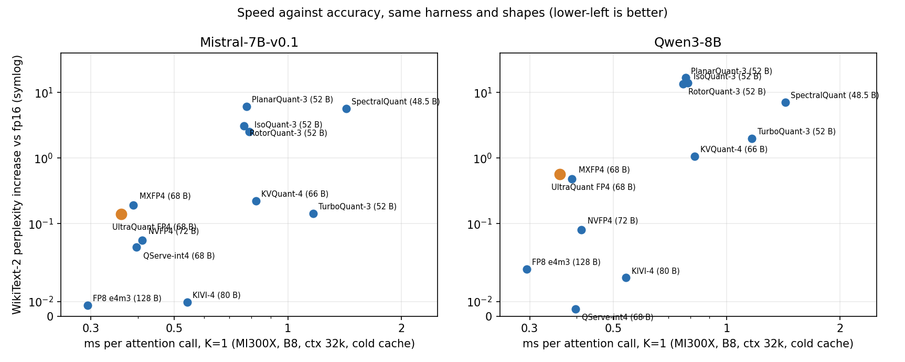
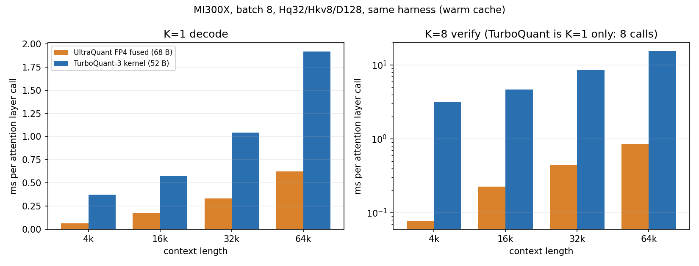

# One FP4 KV-cache verify kernel, three GPU vendors

*UltraQuant (`uqmt`): how we ported it, how it compares with the other KV-cache quantisers, and where it does and does not win.*

Speculative decoding asks the target model to check K draft tokens in one step. In a naive serving stack that check reads the whole KV cache K times, once per drafted token. At long context the KV cache is the dominant memory traffic, so verification cost grows almost linearly with K, which cancels much of the point of speculating.

This repo implements the fix for a specific 4-bit cache format: **one pass over the KV pages serves all K speculative queries and the whole GQA group**. We ran the same operation on AMD, NVIDIA and Intel GPUs, with the same cache layout and the same reference vectors. This post has three parts: how the ports were done and checked, how UltraQuant relates to other schemes (and whether it is the best one), and a like-for-like benchmark against TurboQuant.

Every number below comes from a file under `results/`; the source file is named next to it.

## The format and the operation

UltraQuant stores KV as FP4 (E2M1) values with one UE8M0 power-of-two scale per 32 channels. At head_dim 128 that is 68 bytes per head per token for K or V, which is **3.76x smaller than fp16 and 1.88x smaller than fp8**: the same GPU holds 3.76x more KV tokens.

```
 plain decode of K speculative tokens          fused K-query (this repo)
 q0 -> [read all KV pages] -> o0               q0 \
 q1 -> [read all KV pages] -> o1                q1  |  one tile: M = K x GQA group
 ...                                            ... |-> [read each KV page ONCE] -> o0..oK-1
 qK-1 -> [read all KV pages] -> oK-1            qK-1/    (FP4 -> bf16 in registers, per-query
 HBM traffic: K x KV                                      causal mask, split-KV + LSE reduce)
                                                HBM traffic: 1 x KV
```

Query j of K sees `seq_len - K + j + 1` positions. Each tile stacks the K queries and the GQA group into the M dimension of one matrix multiply, FP4 is expanded to bf16 in registers, and split-KV partial results are merged with a log-sum-exp reduction.

| Vendor | Implementation | Hardware measured |
|---|---|---|
| AMD | Triton kernel (`uqmt/attn.py`) | MI300X |
| NVIDIA | CUDA: `mma.sync` (sm80+), sm90 wgmma variant 3, sm100 tcgen05 variant 4 | A100, H100, L40S, B300, RTX PRO 6000 |
| Intel | SYCL: portable path, XMX `joint_matrix`, ESIMD/DPAS | Arc B390 |

## Part 1. How we ported it, and how we know it is correct

### The method

The Triton kernel is the reference implementation. Every port was held to the same four checks before any performance work counted.

1. **Shared CPU reference vectors.** A torch CPU generator (`tools/gen_vectors.py`, a snapshot of the quantiser and the fp32 reference) writes raw binary cases that every backend loads: 15 cases for CUDA, 9 for SYCL, plus a separate NVFP4 vector set. The cases cover K in 1..16, GQA 1 to 16, head_dim 64/128, pages 16 to 128, ragged lengths, shuffled page tables, sequences shorter than K, and rotated K/Q. A backend that has not matched these has not been benchmarked.
2. **Per-configuration launch sweeps.** The tuned configuration is not the only one tested. The harness runs every launchable configuration (variant, warps, stages, split count) on every vector: 1260 to 1856 launches per GPU, 0 failures on all five NVIDIA GPUs (`results/cuda_*_vectors_check.log`). SYCL runs 9 cases x 4 split counts = 36 runs per path, 36/36 pass on Arc B390 and also on CPU (OpenCL), A100 and H100 (`results/sycl_arcb390_correctness.log`). The NVFP4 path has its own 2016-launch sweep on H100.
3. **Error against an fp32 reference at the benchmark shape.** At B8, ctx 32768, K 1 to 8 the CUDA max abs error is 1.1e-4 to 1.5e-4 on all five GPUs (`cuda_err` in `results/cuda_summary_b8_c32k.json`, `results/cuda2_summary.json`). On the tiny test vectors the outputs are O(1) with few keys, and bf16 rounding of P and of the output alone gives about 2^-8 relative error, so the harness tolerance is `1e-2 + 2^-6 |ref|` (CUDA) or one bf16 ulp (SYCL). The error is identical across configurations, which shows it is arithmetic and not indexing.
4. **Byte-level compatibility with the upstream cache.** We read upstream vLLM's UltraQuant package (the format, store kernel and Triton decode) and checked ours against it (`cuda/UPSTREAM_COMPAT.md`, `results/cuda_compat_H100.json`, `results/cuda_compat_B300.json`):
   - upstream's own store kernel agrees with its torch reference, so that reference is a valid oracle;
   - the upstream array-of-structs block layout converts to our page layout by a byte permute, and the round trip is byte-identical;
   - our quantiser with the paper's scale rule (`round(log2(0.156 * amax))`) matches upstream bit for bit once the negative-zero code is canonicalised; our default rule (`ceil(log2(amax/6))`, which never clips) is *not* bit-identical, and the document says so (scale bytes equal in 40-41% of groups, always equal or one higher);
   - decode outputs on the upstream cache agree to bf16 rounding, not bit for bit, because accumulation order and query precision differ.

### What each backend does

- **CUDA, `mma.sync`.** Two kernels picked by a tuner. Variant 1 dequantises a page to bf16 in shared memory and uses `ldmatrix` plus `mma.m16n8k16`. Variant 2 is warp-independent: FP4 is expanded straight into the `mma` B-fragment registers with a permuted reduction order (Q is gathered with the same permutation), with no CTA barriers in the main loop.
- **CUDA, sm90 variant 3 (H100).** Warp-specialised: a producer warpgroup issues 1D bulk copies, dequant warpgroups write 128B-swizzled bf16 tiles through a byte-to-bf16x2 lookup table, MMA warpgroups run `wgmma` with Q and P in registers and `setmaxnreg` register rebalancing. It took H100 K=8 from 0.431 ms to 0.215 ms (`results/cuda2_summary.json`).
- **CUDA, sm100 variant 4 (B300).** Raw-PTX `tcgen05` with TMEM accumulators. It is correct, but at about 0.35 ms it is K-independent and only wins at K=8 (0.307 ms against 0.350 ms for the `mma.sync` kernel; it is the K=8 configuration in the tables below). The native block-scaled FP4 QK step was studied, not built into the fused kernel.
- **SYCL.** A portable path in plain SYCL (sub-group reductions, SLM tiling), an XMX path with `joint_matrix` bf16 8x16x16 (FP4 dequantised into the VNNI layout the B operand needs, since XMX has no fp4), and an ESIMD path (one hardware thread per (batch, kv-head, split), a 256-entry byte-to-bf16 table held in registers, S^T = K Q^T on DPAS so the online softmax is lane-parallel).

### Engineering lessons

These are the problems that actually cost time, written as lessons. Sources: `cuda/PORTING_LOG.md`, `sycl/PORTING_LOG.md`.

- **Choose the error criterion before the first run.** A 1e-3 absolute target is unreachable on short sequences with a bf16 output (cancellation on O(1) outputs). Define the tolerance as bf16 rounding of the output plus P, and verify at the benchmark shape where the error is 1e-4.
- **Do not rely on denormals.** The Triton bit trick (bf16 bits times 2^126) depends on subnormal 0.5; GPUs may flush denormals. The SYCL ports use an exact table or an integer bit-fold instead, and the CUDA dequant is exact including the subnormal.
- **Packed-pair arithmetic leaks carries.** A 32-bit add of a scale exponent to a packed bf16 pair carried into the high half and produced a +0.6% bias in the ESIMD path. All scale adds are 16-bit lane adds.
- **Error state is sticky.** In CUDA a failed `cudaFuncSetAttribute` for a too-large shared-memory configuration poisoned the next successful launch's `cudaGetLastError()` on the smaller GPUs. The tuner now checks the opt-in limit and clears errors. Check `ptxas -v` too: a one-kilobyte register spill in one variant was invisible otherwise.
- **Measure before modelling.** The first performance guesses (dequant-ALU bound, block-table latency) were both wrong. Removing dequant and MMA entirely still gave 0.143 ms on B300; load-only and `clock64` ablations located the real limit (compute-path latency at register-limited occupancy; load-only reaches 79% of HBM peak on B300, 87% on H100). On H100 the per-page barrier between two dequant warpgroups was the serialisation point; a dedicated producer plus a per-stage release barrier removed it.
- **Calibrate the roofline with representative data.** On Arc B390 a read kernel over uniformly filled memory reports 430-455 GB/s because that data compresses; with random bytes the same kernel, plain loads and ESIMD block loads all give 105-113 GB/s (`results/sycl2_summary.json`: 108.6 GB/s). Quoting percentages of the wrong peak overstates headroom; the benchmark now prints both.
- **Register and shared-memory budgets differ per architecture.** The register file is split per SM sub-partition, so a 17-warp CTA gets 96 registers per thread, not 120. A `setmaxnreg` request above the launch allocation hangs, so mbarrier waits spin with a bounded `__trap()`. The same source had to survive 99 KB shared memory on L40S/RTX and on Arc work-group size and SLM footprint interact sharply (work-group 256 was twice as fast as its neighbours; a "cleaner" three-barrier schedule was twice as slow because of SLM-limited occupancy).
- **Keep dispatch honest.** A default-config bug (a variant that spilled 700 bytes of stack for M >= 32 rows) cost about 2.7 ms per call in one whole-step run; the default now uses variant 1 there.
- **Keep the negative results.** A sub-group-private `joint_matrix` pipeline with no barriers was correct (36/36) but 2.5x slower than the barrier version, and wider 16-byte loads were slower. Both are documented and reverted.

### Effort

| | CUDA | SYCL |
|---|---|---|
| Wall time | about 2.5 hours to the five-GPU tables (single session) | one overnight session for the portable, XMX and ESIMD paths |
| New code | about 1.5 kLOC (kernels 560 + 310, host/binding 120, harness and bench about 290, generator 120) | `uq_decode.hpp` about 255 lines, `uq_xmx.hpp` about 200, harness and bench about 260 |
| Correctness bugs found on hardware in the kernels | 0 (first run was correct on H100 and B300) | 0 (first XMX run correct); the first portable run's two "failures" were a tolerance that ignored bf16 P rounding |

For scale, the TurboQuant-on-AMD effort in `Bobliuuu/amd-experiments` was 15 commits over two weeks, including a HIP library, a 1,834-line Triton file and custom code-object loaders. That comparison is not like-for-like: TurboQuant also needs rotations, Lloyd-Max codebooks and bit-plane packing, our ports are one op with a published layout and an existing reference to match, and neither effort was integrated into a serving engine by the porting agent. Most of our time went to performance tuning and the hardware matrix, not to getting the first kernel correct.

## Part 2. How UltraQuant relates to other schemes, and whether it is the best

Short answer: **no. UltraQuant is not the most accurate scheme here, and FP8 is faster at K=1.** It is faster and more accurate than TurboQuant 3-bit, it is far ahead of SpectralQuant and of Planar/Iso/Rotor at 3 bits, and it keeps two things the others do not have in this table: a fused K-query kernel over the cache and the same op on three vendors with the upstream cache layout.

To make that claim testable, every method below was given a real fused Triton decode kernel on the same MI300X and run through one harness (`bench/ports/common.py`, `bench/ports/run_port.py`, summary in `results/ports_summary.md`). One table, one set of shapes: B8, ctx 32768, Hq64/Hkv8/D128, page 64, cold cache (the 256 MB Infinity Cache flushed before every call). GB/s counts stored KV bytes only. The ms and cosine columns come from `results/ports_*.json`; the perplexity and real-KV cosine columns come from the same files for the ported methods, from `results/quality_raw/` for UltraQuant, TurboQuant and the three block-rotation methods (earlier runs with the identical protocol), and from `results/spectralquant_quality_*.json` for SpectralQuant. Sorted by K=1 time.

| method | B/vec | ms K=1 | ms K=8 | GB/s K=1 | kernel attn cos | ppl delta Mistral | ppl delta Qwen3 | attn cos real KV Mistral / Qwen3 | marker |
|---|---|---|---|---|---|---|---|---|---|
| FP8 e4m3 | 128 | 0.294 | 0.510 | 1825 | 0.998 | +0.008 | +0.032 | 0.998 / 0.997 | ported kernel |
| **UltraQuant FP4 (this repo)** | 68 | 0.361 | 0.551 | 790 | 0.965 | +0.139 | +0.562 | 0.963 / 0.932 | ported kernel (repo) |
| MXFP4 | 68 | 0.389 | 0.538 | 734 | 0.962 | +0.190 | +0.482 | 0.943 / 0.923 | ported kernel |
| QServe-int4 | 68 | 0.397 | 0.629 | 719 | 0.981 | +0.047 | +0.005 | 0.985 / 0.963 | ported kernel |
| NVFP4 | 72 | 0.411 | 0.536 | 735 | 0.981 | +0.056 | +0.081 | 0.989 / 0.979 | ported kernel |
| KIVI-4 | 80 | 0.540 | 0.784 | 621 | 0.993 | +0.010 | +0.026 | 0.996 / 0.998 | ported kernel |
| RotorQuant-3 | 52 | 0.766 | 1.583 | 285 | 0.905 | +3.089 | +13.395 | 0.709 / 0.722 | ported kernel; quality from quantiser sim |
| PlanarQuant-3 | 52 | 0.777 | 1.575 | 281 | 0.896 | +6.101 | +16.703 | 0.699 / 0.716 | ported kernel; quality from quantiser sim |
| IsoQuant-3 | 52 | 0.790 | 1.584 | 276 | 0.916 | +2.537 | +13.870 | 0.713 / 0.721 | ported kernel; quality from quantiser sim |
| KVQuant-4 | 66 | 0.822 | n/a | 337 | 0.949 | +0.220 | +1.064 | 0.811 / 0.864 | ported kernel |
| TurboQuant-3 | 52 | 1.168 | 8.651 | 187 | 0.937 | +0.142 | +1.995 | 0.968 / 0.933 | ported kernel (amd-experiments, K calls) |
| SpectralQuant | 48.5 | 1.429 | 1.733 | 142 | 0.931 | +5.664 | +7.018 | 0.787 / 0.790 | ported kernel (own Triton, package semantics) |

Reading the columns:
- *kernel attn cos* is the cosine between the kernel output and fp32 attention on synthetic LLM-like KV (the harness's `make_kv`), at K=1. *attn cos real KV* is the per-layer cosine on real post-RoPE K/V of the two models over the last 128 queries. Mistral-7B-v0.1 and Qwen3-8B, WikiText-2, 8 windows of 2048 tokens, first 1024 via chunked prefill and the rest token by token (`bench/quality/qeval.py`, `results/quality_summary.md`). Single run per cell, so perplexity differences under about 0.02 are noise. The ported methods were re-run with an fp16 baseline of 4.872 / 8.522; `results/quality_raw` has 4.873 / 8.522.
- *ported kernel* means a real decode kernel was run in this harness. For Planar/Iso/Rotor the perplexity comes from the identical quantiser run as a quantise-dequantise simulation (`results/quality_raw`) and not through the Triton kernel; the kernel is checked against that quantiser (`results/ports_blockrot_notes.md`). Quantisers that have no kernel (for example KIVI-2) are not in this table; they are in `results/quality_summary.md`, labelled quality only.
- fp16 SDPA on the same shapes takes 1.473 ms at K=1 and 1.477 ms at K=8 at 256 B per vector (`results/ports_summary.md`).



*Chart: same data as the table (`results/ports_*.json`, `results/quality_raw/`, `results/spectralquant_quality_*.json`), rendered by `blog/make_charts.py`. Lower-left is better; the vertical axis is symlog.*

### Is UltraQuant the best? Where it loses and where it wins

**Where it loses.**
- **At equal bytes, QServe-int4 is better on accuracy.** Both store 68 B/vec and the speed is close (K=1 0.361 against 0.397 ms, K=8 0.551 against 0.629 ms: UltraQuant is 9 to 12% faster), but QServe-style per-token int4 with SmoothAttention shows +0.047 / +0.005 perplexity (Mistral / Qwen3) against +0.139 / +0.562.
- **NVFP4 is more accurate for +4 B.** +0.056 / +0.081 for 72 B/vec, at 0.411 against 0.361 ms at K=1; at K=8 the two are within 3% (0.536 against 0.551 ms). This is why the README recommends the NVFP4 scale path when upstream bit-compatibility is not needed.
- **FP8 and KIVI-4 are more accurate** (perplexity delta at most 0.032) for 1.9x and 1.2x the bytes. FP8 is also faster at K=1 (0.294 against 0.361 ms; K=8 0.510 against 0.551 ms): dequantisation is one convert, so it reaches 47% of the HBM copy peak, whereas the FP4 kernels reach about 20%. On gfx942 4-bit storage does not buy speed over FP8 at small K; the UltraQuant advantage over FP8 is capacity (3.8x against 2x), not latency. KIVI-4 is slower (0.540 ms) because of per-channel scale and min traffic and its bf16 residual window.
- **KVQuant-4 (dense) is behind on both axes here.** 66 B/vec, 0.822 ms at K=1 (K=4 and K=8 timings are not in `results/ports_kvquant.json` yet), perplexity +0.220 / +1.064 and real-KV cosine 0.811 / 0.864. This is the dense-only path of the scheme (no sparse outliers, no attention-sink fp16 token, no Fisher weighting), the K codebook is calibrated offline on WikiText-2 train, and the port keeps pre-RoPE keys and applies RoPE inside the kernel. The full scheme with outliers would sit higher on accuracy; it was not ported. The earlier quantise-dequantise row for KVQuant-4 in `results/quality_summary.md` (+0.041 / -0.007) is a different implementation and the two should not be mixed.
- **MXFP4 shares our kernel.** Same bytes and same speed by construction; only the scale rule differs. The OCP floor-exponent rule is worse on Mistral (+0.190 against +0.139) and better on Qwen3 (+0.482 against +0.562), so neither scale rule is uniformly ahead.

**Where it wins.**
- **Against TurboQuant 3-bit (52 B).** Perplexity delta is +0.139 / +0.562 against +0.142 / +1.995, so equal on Mistral and much better on Qwen3. It is 3.2x faster at K=1 (0.361 against 1.168 ms) and 15.7x faster at K=8 (0.551 against 8.651 ms), because the TurboQuant kernel has no K-query mode and K calls are needed. TurboQuant stores 24% fewer bytes. TurboQuant 4-bit (68 B) is a closer accuracy match and is ahead on Mistral; it was run only through the quality harness (`results/quality_summary.md`), so it has no speed row here.
- **Against SpectralQuant (48.5 B).** About 3x to 4x faster (0.361 against 1.429 ms at K=1, 0.551 against 1.733 ms at K=8, `results/ports_summary.md`) and much more accurate: +0.139 / +0.562 against +5.664 / +7.018 perplexity, real-KV attention cosine 0.963 / 0.932 against 0.787 / 0.790. SpectralQuant does store fewer bytes. Our port is dequantisation-bound at 117 to 142 GB/s, so a register-resident codebook or a HIP kernel could narrow the speed gap; that was not attempted (`results/spectralquant_summary.md`).
- **Against PlanarQuant / IsoQuant / RotorQuant at 3 bits (52 B).** Their fused kernels time the same as each other (0.766 to 0.790 ms at K=1, 1.575 to 1.584 ms at K=8), so UltraQuant is 2.1x to 2.2x faster at K=1 and 2.9x at K=8. Perplexity delta is +2.5 to +6.1 on Mistral and +13.4 to +16.7 on Qwen3, against +0.139 / +0.562. This is not a port bug: our port matches the amd-experiments quantiser (cosine 1.0000), and on real keys a block-local 2D/3D/4D rotation cannot spread a dominant channel. Qwen3 keys put on average 26% of their energy in one channel against 6.6% on Mistral (`results/ports_blockrot_diag_realkv.json`, `results/ports_blockrot_notes.md`). We do not claim the upstream repositories behave this way with their own pipelines.
- **Fused K-query and layout.** At K=8 the fused UltraQuant call costs 1.5x a K=1 call (0.551 against 0.361 ms). FP8, NVFP4, MXFP4 and KIVI-4 are fused in the same way, and QServe-int4 uses a plain K-query tile, so the speed advantage over them here comes from format and kernel, not from K-sharing. What UltraQuant adds is that the format is the upstream UltraQuant cache layout (byte permute, Part 1) and the same op runs on CUDA and SYCL.

**Fairness conditions.**
- Same harness, same shapes, same cold-cache timer for every row; timings are single runs on a shared GPU serialised by a lock, noise about 5%.
- KIVI-4 and QServe use the plain K-query tile (a tile of K x GQA-group rows over one KV pass), because their papers have no fused multi-query design. TurboQuant's kernel has no K-query mode, so it is timed as K independent calls (its K=8 timing is the sum of eight calls).
- FP8 scales and QServe SmoothAttention lambdas are calibrated online from the first K/V a layer sees, a stand-in for offline calibration.
- SpectralQuant uses its default `standard` preset only, calibrated on one WikiText-2 set, written from the open-source Dynamis-Labs `spectralquant` package (version 0.3.1). There is no arXiv paper, and the repository's paper PDF could not be fetched, so the port follows the shipped code. Other presets were not run; more bits would trade bytes for accuracy.
- UltraQuant and TurboQuant quality rows are from earlier `results/quality_raw` runs, not re-measured in the port session.
- Kernel attention cosine is on synthetic KV and mostly reflects the data distribution; the real-KV columns are the ones to trust.

**Draft acceptance falls with 4-bit KV.** Probability that all 8 verified tokens match fp16 (`accept@8`, Qwen3-8B, `results/quality_summary.md`): fp16 0.985, FP8 (scaled) 0.825, KIVI-4 0.795, NVFP4 0.460, UltraQuant 0.265. On Mistral-7B: UltraQuant 0.610, NVFP4 0.740. This offsets part of the per-step speed gain, so quality has to be checked per model. The paper's scale constant (c = 0.156) did not transfer to these two models (+0.310 / +0.929 here, `uq_fp4_c156` in `results/quality_summary.md`); the repo's scale rule equals the paper's `round(log2(c*amax))` at c = 0.236 (`docs/SCALE_RULE.md`).

### Porting the comparison methods

The comparison methods were ported with the same discipline as the UltraQuant kernels: a real fused kernel, checked against the quantiser it reads (own-cache relative error about 2e-3 for the FP8/FP4 formats, about 5e-3 for KIVI and QServe where bf16 rounding of p x scale and the residual enters), then timed. Numbers are from `bench/ports/PORTING_LOG.md`, `results/ports_blockrot_notes.md` and `results/spectralquant_summary.md`. LOC counts kernel plus port module; hours are agent wall-clock including debugging and excluding time queued for the shared GPU.

| Method | Kernel design | LOC | Hours | Deviations from the published scheme |
|---|---|---|---|---|
| FP8 e4m3 | 1 B/element, per-tensor scale folded into the softmax scale and the combine kernel | 128 | 0.7 | e4m3fnuz (native on gfx942, max 240); scale from the whole written tensor |
| NVFP4 | existing `uqmt/nvfp4.py` kernel behind the harness | 62 (+278 reused) | 0.3 | none in the format; per-tensor scale from the written tensor |
| MXFP4 | UltraQuant UE8M0/32 kernel, OCP floor-exponent quantiser | 71 | 0.4 | none; no rotation |
| KIVI-4 | per-channel K, per-token V, plus a bf16 residual window of 128 to 159 tokens read in the same pass | 245 | 1.5 | channel-pair packing for K (same bytes, same math); bf16 residual; static cache |
| QServe KV4 | per-token asymmetric int4, SmoothAttention lambda applied to q in-kernel | 174 | 1.0 | lambda from written post-RoPE K, not offline pre-RoPE calibration; Triton bf16 instead of the CUDA PRMT kernel; KV only |
| KVQuant-4 (dense nuq4) | per-channel static K (pre-RoPE, RoPE in kernel), per-token V, per-layer 4-bit non-uniform codebooks | about 230 (core 83, kernel 81, port 66) | not logged | dense path only: no sparse outliers, no sink token, no Fisher weighting; K=4/8 timings not yet recorded |
| Planar / Iso / Rotor 3 and 4 bit | bit-plane storage, dense 128x128 block rotation outside the kernel, shared decode kernel | about 230 for all | about 3 | bit-plane storage (52 / 68 B) instead of int8 indices; Rotor drops the pad-derived 129th coordinate; single seed-42 rotation as upstream; no QJL |
| SpectralQuant | calibration, quantise-on-write kernel, fused split-KV decode with per-dimension LUT dequant | about 440 | about 4 | written from the package semantics, no upstream GPU kernel; exact Lloyd-Max codebooks; QJL not implemented (off by default); no paging |

Plumbing (adapters, nsplit tuner, quality hook, sync script) took about 0.8 h. The block-rotation kernel needed one rewrite (byte-gather plus LUT gather 1.20 ms to expand-bits-in-registers plus select chain 0.78 ms at K=1), and the SpectralQuant port gained 1.4x from a launch-parameter sweep (2.012 to 1.429 ms at K=1, `results/spectralquant_tune.json`). The kernels are not tuned beyond that, so the table is a statement about these ports on this GPU, not about the best possible kernel for each method.

### Speed, where a kernel exists

Speed is only reported for schemes with a kernel, and the GPUs differ, so read each block separately.

| Kernel (GPU, shape) | K=1 ms | K=8 ms | Source |
|---|---|---|---|
| UltraQuant CUDA (B300, B8 ctx32768 Hq64/Hkv8) | 0.139 | 0.307 | `results/cuda2_summary.json` |
| FlashInfer trtllm-gen NVFP4, fp8 query (B300, same shape) | 0.066 | 0.094 | `results/priorart_B300.json` |
| FlashInfer trtllm-gen fp8 KV, fp8 query (B300) | 0.080 | 0.087 | `results/priorart_B300.json` |
| BitDecoding-FP4 (B300; K independent decodes) | 0.068 | 0.521 | `results/priorart_B300.json` |
| UltraQuant Triton (MI300X, same shape) | 0.361 | 0.542 | `results/mi300x_b8_c32k_tuned.json` |

On B300 the vendor-tuned NVFP4 kernel is 2.1x faster than ours at K=1 and 3.3x faster at K=8. It uses `tcgen05` tensor cores, a different scale format (E4M3 per 16 plus an fp32 global scale) and an fp8 query. We do not beat it, and fused K-query verify over an FP4 cache already exists there, so we do not claim that idea. On the A100 and H100 the NVFP4 scale path in our own kernels costs 0.1% to 2.5% more time than UE8M0 for the 72-byte layout (`results/nvfp4_summary.md`).

### Where UltraQuant is a good choice, and where it is not

**Where it fits.**
- You want the **68-byte, 3.76x** capacity win and a **fused K-query verify** over that exact cache, rather than K re-reads. Fused K=8 costs about 1.5x a K=1 call on MI300X, not 8x (`results/mi300x_b8_c32k_tuned.json`).
- You need **one validated op across AMD, NVIDIA and Intel**, with a cache that is layout-compatible with the upstream vLLM/SGLang UltraQuant cache by a byte permute.
- **Large batch, long context, speculative verify.** On Mistral-7B shapes on MI300X the fused kernel is 1.0x to 1.75x faster per call than the best fp16 attention (cold cache), and a whole decode step is 1.4x to 1.6x faster at batch 8 with 16k to 32k context and K=8 (`results/h2h_summary.md`, `results/e2e_summary.md`; the step numbers are a projection from GPU kernel time).

**Where it loses.**
- **Accuracy-first deployments:** FP8, KIVI-4, QServe-int4 and NVFP4 are closer to fp16 (table above).
- **Speed on Blackwell:** FlashInfer's NVFP4 path is faster on B300 (table above).
- **Batch 1 and short context:** the whole-step gain is about 1.0x (0.96x to 1.15x); attention is only 4-17% of the step there (`results/e2e_summary.md`).
- **Smaller formats:** TurboQuant 3-bit (52 bytes) and KIVI-2 (48 bytes) store fewer bytes per vector; they pay for it in accuracy in the table above.
- **MI300X and Arc** decode FP4 in software (no scaled FP4 MFMA on gfx942; no fp4 on XMX), so most of the byte saving is not converted into time. The native path needs gfx950, which we have not measured.

## Part 3. Benchmark against TurboQuant

TurboQuant here is the AMD port from `amd-experiments`, **kernels run unchanged**, on the same MI300X as our Triton kernel. The goal is a comparison nobody can accuse of tuning one side.

**What is the same.**
- One harness (`bench/h2h_microbench.py`), one device, one timer (CUDA-event mean over 30 repetitions, around 10 for the largest shapes).
- The same shapes: Hq/Hkv = 32/8 (Mistral-7B) and 64/8, head_dim 128, batch 1, 8 and 32, context 4096 to 65536, on identical synthetic Gaussian KV. Accuracy scripts use the same two real models (Mistral-7B-v0.1, Qwen3-8B) through the same cache path as every other row in Part 2.
- Warm-cache and cold-cache (Infinity Cache flushed before every call) runs are both reported.
- Our kernel gets the best split count from {8, 16, 32, 64}; theirs is their autotuned split-K GQA path. TurboQuant's timing includes the 128x128 inverse output rotation; the query rotation is shown separately.

**What each method supports, and what differs.**

| | UltraQuant (this repo) | TurboQuant-3 (amd-experiments) |
|---|---|---|
| Bytes per vector | 68 | 52 (4 B norm + 3 x 16 B bit planes) |
| Query tokens per call | K up to 16, per-query causal masks | **K = 1 only** |
| KV layout | paged | contiguous, non-paged |
| Scheme | FP4 + UE8M0 per 32 | rotation + Lloyd-Max codebook, 3 bit |

For K = 8 we therefore report TurboQuant two ways: eight sequential single-query calls (what a serving stack has to do today), and one call with `S_q = 8` timed without causal masking, a timing-only lower bound for them that is not a valid verify. The second is the more favourable reading for TurboQuant.

**Results (MI300X, Hq32/Hkv8, `results/h2h_summary.md`, raw `results/h2h_raw_B*_c*.json`).**

| Shape (B, ctx) | UltraQuant K=1 | TurboQuant-3 K=1 | UltraQuant K=8 fused | TurboQuant-3 K=8 as 8 calls | TurboQuant-3 K=8 one call, no causal |
|---|---|---|---|---|---|
| 8, 32768 | 0.330 ms | 1.043 ms | 0.442 ms | 8.479 ms | 6.935 ms |
| 8, 32768 (cold cache) | 0.357 ms | 1.135 ms | 0.477 ms | 8.534 ms | not run |

- **K=1:** across the 12 shapes (batch 1/8/32 x context 4k-64k), UltraQuant is 2.8x to 6.1x faster at Hq32/Hkv8 and 2.7x to 6.0x at Hq64/Hkv8. The gap is smallest at long context with batch 1 (2.7-2.8x at 64k).
- **K=8:** fused UltraQuant is 18x to 50x faster than eight TurboQuant calls at Hq32 (13x to 41x at Hq64), because it reads the cache once and TurboQuant cannot.
- **Bytes:** TurboQuant reads 52/68 of what UltraQuant reads, so on a bytes-only model it would be about 1.3x faster. Its measured time is higher because its kernel reaches a lower effective bandwidth (about 0.2 TB/s against UltraQuant's 0.8-1.0 TB/s of KV traffic at large batch, `results/h2h_summary.md`).
- **Accuracy at these shapes** (same synthetic KV, attention-output cosine vs fp16): UltraQuant 0.986 (iid) / 0.993 (peaked) against TurboQuant-3 0.965 / 0.982. On real Mistral-7B K/V at 4096 tokens the two are equal: 0.9757 against 0.9756 (`results/real_kv_summary.md`). Synthetic accuracy mostly reflects the data distribution, so the real-KV row is the one to trust. TurboQuant at 4 bits (68 bytes) is the better accuracy match for UltraQuant, and in Part 2 it is ahead on Mistral-7B perplexity.



*Chart: `results/h2h_raw_B8_c*.json`, warm cache, rendered by `blog/make_charts.py`.*

**Caveats.** TurboQuant's kernel is non-paged and K=1-only by design, and its TQ3 format is smaller, so this is not a pure kernel-quality contest. We measured one GPU (MI300X). Both kernels are ALU/latency-bound for the same underlying reason: decoding sub-byte KV costs more issue slots than its bytes cost in memory time at decode sizes.

## Other vendors, briefly

- **NVIDIA** (B8, ctx 32768, Hq64/Hkv8, `results/cuda_summary_b8_c32k.json`, `results/cuda2_summary.json`): K=1 / K=8 are 0.139 / 0.307 ms on B300 (K=8 uses the tcgen05 variant), 0.163 / 0.215 ms on H100 (wgmma variant) and 0.259 / 0.709 ms on A100. The CUDA port is 1.05x to 2.8x faster than our Triton kernel on every NVIDIA GPU measured.
- **Intel Arc B390** (B8, 16k context, `results/sycl2_summary.json`, `results/sycl2_baselines_*.json`): the ESIMD/DPAS path takes 1.72 / 1.77 / 3.47 ms at K=1/4/8, against 2.62 / 3.49 / 7.24 ms for the earlier XMX path and 4.90 / 5.87 / 5.81 ms for torch-XPU f16 SDPA, while reading 3.8x fewer bytes. llama.cpp's integer q4_0 KV (non-paged, not the UltraQuant format) is competitive at K=1 (2.03 ms) and slower at K>=4. The K=1 kernel reaches 76% of the 108.6 GB/s random-data read ceiling; at K=8 it is ALU-bound (38%). FP4 is decoded in software.

## What we contribute, and what is not new

**Not new, and we do not claim it:**
- Sharing KV reads across several queries. FlashInfer multi-query decode, tree attention and other verify kernels already do it.
- A new FP4 algorithm. The format is UltraQuant's, from its paper and the AMD work around it.
- Fused FP4 multi-token verify on NVIDIA in general: FlashInfer's trtllm-gen kernels do it for NVFP4 on Blackwell and are faster than our port on B300.

**What we contribute, as far as we can find:**
1. **The UltraQuant format with fused K-query verify, ported to CUDA and SYCL.** The format and a vLLM backend for it already exist upstream (vLLM PR #57057, merged 2026-10-06): AMD gfx950 FlyDSL decode plus a Triton fallback, listed for ROCm only in the source we read, with single-query decode paths. We ran that backend at serving level on MI300X (below) but did not time it as a kernel against ours. In the public sources we checked we found no CUDA or SYCL implementation of the format with fused K-query verify, and no FP4 KV decode on Intel/SYCL. The search trails are in [cuda/PRIOR_ART.md](../cuda/PRIOR_ART.md) and [sycl/PRIOR_ART.md](../sycl/PRIOR_ART.md). This is a "no public port found" statement; the search was not exhaustive.
2. **One validated op across three vendors**, with a layout that drops into the upstream cache by permutation (Part 1).
3. **A reproducible comparison** of KV quantisers with real fused kernels on one MI300X harness and two models (Part 2), and against TurboQuant at more shapes (Part 3).

## Serving-level check on MI300X (vLLM's native backend, not our kernel)

We ran vLLM 0.33.0 on MI300X with Qwen3-8B and three KV formats: bf16, fp8 and vLLM's native `ultraquant_4bit` backend (its own FlyDSL/Triton kernel). Mistral-7B cannot use that backend (sliding window). The FP4 runs needed `--attention-backend TRITON_ATTN`, so backend and KV format are confounded in every speed number. Each cell is one run on a GPU shared with other jobs.

| metric | bf16 KV | fp8 KV | FP4 KV |
|---|---|---|---|
| KV capacity, tokens | 1.09M | 2.18M (2.00x) | 3.16M (2.89x) |
| RAG HotpotQA-in-16k F1, n=100 | 0.655 | 0.647 | 0.618 |
| Median first divergent greedy token vs bf16 | reference | 24 | 10 |
| Agent (32 x 24k sessions, KV oversubscribed) tok/s | 47.9 | 38.1 | 59.4 |
| Agent TTFT p50 (s) | 69 | 74 | 30 |
| Plain decode (K=0) tok/s | 1052 | 1091 | 767 |

The capacity gain and the oversubscribed-agent gain are real: bf16 KV holds 185k tokens in the agent configuration and FP4 holds 544k,. Plain decode is slower with FP4, and the quality cost is real (F1 about 0.04 lower; greedy output diverges from bf16 after about 10 tokens versus 24 for fp8). Speculative K=4/8 numbers exist but are noisy (bf16 K=4 is slower than bf16 K=0), so we do not draw conclusions from them. This supports the KV-capacity argument for FP4; it is not a kernel-speed claim for the kernel in this repo. Data: `results/realworld_mi300x_summary.md` and `results/realworld_mi300x_*.json`.

## What this does not show yet

- No serving-level number for **our** kernel. The serving numbers below are for vLLM's native `ultraquant_4bit` backend, and our step numbers are kernel-level measurements and a projection.
- Perplexity and cosine come from single runs on small samples, the Planar/Iso/Rotor perplexity comes from a quantiser simulation rather than the kernel, and the comparison kernels are untuned ports; task accuracy (RULER, SWE-bench style) is not measured.
- MI300X (gfx942) has no native scaled FP4 MFMA; the native path needs gfx950, which we have not measured.
- At batch 1 there is no whole-step gain. The reliable benefit is **3.76x more KV tokens per GB**, plus cheaper verification at large batch and long context.

## Try it

```bash
pip install git+https://github.com/Bobliuuu/ultraquant-more
```

```python
import torch, uqmt
cache = uqmt.build_paged_cache(k, v, page_size=64, seq_lens=[4096] * 8)
out = cache.decode(q)   # q: [B, K, Hq, D], K = 1 + speculative tokens
```

CUDA and SYCL builds: [cuda/README.md](../cuda/README.md), [sycl/README.md](../sycl/README.md). Charts: `python blog/make_charts.py`. Explainer video: [video/ultraquant_explainer.mp4](../video/ultraquant_explainer.mp4).
