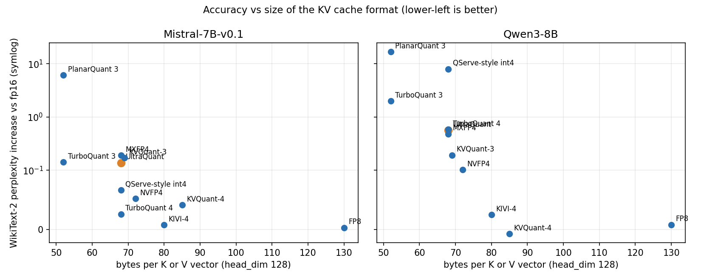

# One FP4 KV-cache verify kernel, three GPU vendors

*UltraQuant (`uqmt`): how we ported it, how it compares with the other KV-cache quantisers, and where it does and does not win.*

Speculative decoding asks the target model to check K draft tokens in one step. In a naive serving stack that check reads the whole KV cache K times, once per drafted token. At long context the KV cache is the dominant memory traffic, so verification cost grows almost linearly with K, which cancels much of the point of speculating.

This repo implements the fix for a specific 4-bit cache format: **one pass over the KV pages serves all K speculative queries and the whole GQA group**. We ran the same operation on AMD, NVIDIA and Intel GPUs, with the same cache layout and the same reference vectors. This post has three parts: how the ports were done and checked, how UltraQuant relates to other schemes (and whether it is the best one), and a like-for-like benchmark against TurboQuant.

Every number below comes from a file under `results/`; the source file is named next to it.

## The format and the operation

UltraQuant stores KV as FP4 (E2M1) values with one UE8M0 power-of-two scale per 32 channels. At head_dim 128 that is 68 bytes per head per token for K or V, which is **3.76x smaller than fp16 and 1.88x smaller than fp8**: the same GPU holds 3.76x more KV tokens.

```
 plain decode of K speculative tokens          fused K-query (this repo)
 q0 -> [read all KV pages] -> o0               q0 \
 q1 -> [read all KV pages] -> o1                q1  |  one tile: M = K x GQA group
 ...                                            ... |-> [read each KV page ONCE] -> o0..oK-1
 qK-1 -> [read all KV pages] -> oK-1            qK-1/    (FP4 -> bf16 in registers, per-query
 HBM traffic: K x KV                                      causal mask, split-KV + LSE reduce)
                                                HBM traffic: 1 x KV
```

Query j of K sees `seq_len - K + j + 1` positions. Each tile stacks the K queries and the GQA group into the M dimension of one matrix multiply, FP4 is expanded to bf16 in registers, and split-KV partial results are merged with a log-sum-exp reduction.

| Vendor | Implementation | Hardware measured |
|---|---|---|
| AMD | Triton kernel (`uqmt/attn.py`) | MI300X |
| NVIDIA | CUDA: `mma.sync` (sm80+), sm90 wgmma variant 3, sm100 tcgen05 variant 4 | A100, H100, L40S, B300, RTX PRO 6000 |
| Intel | SYCL: portable path, XMX `joint_matrix`, ESIMD/DPAS | Arc B390 |

## Part 1. How we ported it, and how we know it is correct

### The method

The Triton kernel is the reference implementation. Every port was held to the same four checks before any performance work counted.

1. **Shared CPU reference vectors.** A torch CPU generator (`tools/gen_vectors.py`, a snapshot of the quantiser and the fp32 reference) writes raw binary cases that every backend loads: 15 cases for CUDA, 9 for SYCL, plus a separate NVFP4 vector set. The cases cover K in 1..16, GQA 1 to 16, head_dim 64/128, pages 16 to 128, ragged lengths, shuffled page tables, sequences shorter than K, and rotated K/Q. A backend that has not matched these has not been benchmarked.
2. **Per-configuration launch sweeps.** The tuned configuration is not the only one tested. The harness runs every launchable configuration (variant, warps, stages, split count) on every vector: 1260 to 1856 launches per GPU, 0 failures on all five NVIDIA GPUs (`results/cuda_*_vectors_check.log`). SYCL runs 9 cases x 4 split counts = 36 runs per path, 36/36 pass on Arc B390 and also on CPU (OpenCL), A100 and H100 (`results/sycl_arcb390_correctness.log`). The NVFP4 path has its own 2016-launch sweep on H100.
3. **Error against an fp32 reference at the benchmark shape.** At B8, ctx 32768, K 1 to 8 the CUDA max abs error is 1.1e-4 to 1.5e-4 on all five GPUs (`cuda_err` in `results/cuda_summary_b8_c32k.json`, `results/cuda2_summary.json`). On the tiny test vectors the outputs are O(1) with few keys, and bf16 rounding of P and of the output alone gives about 2^-8 relative error, so the harness tolerance is `1e-2 + 2^-6 |ref|` (CUDA) or one bf16 ulp (SYCL). The error is identical across configurations, which shows it is arithmetic and not indexing.
4. **Byte-level compatibility with the upstream cache.** We read upstream vLLM's UltraQuant package (the format, store kernel and Triton decode) and checked ours against it (`cuda/UPSTREAM_COMPAT.md`, `results/cuda_compat_H100.json`, `results/cuda_compat_B300.json`):
   - upstream's own store kernel agrees with its torch reference, so that reference is a valid oracle;
   - the upstream array-of-structs block layout converts to our page layout by a byte permute, and the round trip is byte-identical;
   - our quantiser with the paper's scale rule (`round(log2(0.156 * amax))`) matches upstream bit for bit once the negative-zero code is canonicalised; our default rule (`ceil(log2(amax/6))`, which never clips) is *not* bit-identical, and the document says so (scale bytes equal in 40-41% of groups, always equal or one higher);
   - decode outputs on the upstream cache agree to bf16 rounding, not bit for bit, because accumulation order and query precision differ.

### What each backend does

- **CUDA, `mma.sync`.** Two kernels picked by a tuner. Variant 1 dequantises a page to bf16 in shared memory and uses `ldmatrix` plus `mma.m16n8k16`. Variant 2 is warp-independent: FP4 is expanded straight into the `mma` B-fragment registers with a permuted reduction order (Q is gathered with the same permutation), with no CTA barriers in the main loop.
- **CUDA, sm90 variant 3 (H100).** Warp-specialised: a producer warpgroup issues 1D bulk copies, dequant warpgroups write 128B-swizzled bf16 tiles through a byte-to-bf16x2 lookup table, MMA warpgroups run `wgmma` with Q and P in registers and `setmaxnreg` register rebalancing. It took H100 K=8 from 0.431 ms to 0.215 ms (`results/cuda2_summary.json`).
- **CUDA, sm100 variant 4 (B300).** Raw-PTX `tcgen05` with TMEM accumulators. It is correct, but at about 0.35 ms it is K-independent and only wins at K=8 (0.307 ms against 0.350 ms for the `mma.sync` kernel; it is the K=8 configuration in the tables below). The native block-scaled FP4 QK step was studied, not built into the fused kernel.
- **SYCL.** A portable path in plain SYCL (sub-group reductions, SLM tiling), an XMX path with `joint_matrix` bf16 8x16x16 (FP4 dequantised into the VNNI layout the B operand needs, since XMX has no fp4), and an ESIMD path (one hardware thread per (batch, kv-head, split), a 256-entry byte-to-bf16 table held in registers, S^T = K Q^T on DPAS so the online softmax is lane-parallel).

### Engineering lessons

These are the problems that actually cost time, written as lessons. Sources: `cuda/PORTING_LOG.md`, `sycl/PORTING_LOG.md`.

- **Choose the error criterion before the first run.** A 1e-3 absolute target is unreachable on short sequences with a bf16 output (cancellation on O(1) outputs). Define the tolerance as bf16 rounding of the output plus P, and verify at the benchmark shape where the error is 1e-4.
- **Do not rely on denormals.** The Triton bit trick (bf16 bits times 2^126) depends on subnormal 0.5; GPUs may flush denormals. The SYCL ports use an exact table or an integer bit-fold instead, and the CUDA dequant is exact including the subnormal.
- **Packed-pair arithmetic leaks carries.** A 32-bit add of a scale exponent to a packed bf16 pair carried into the high half and produced a +0.6% bias in the ESIMD path. All scale adds are 16-bit lane adds.
- **Error state is sticky.** In CUDA a failed `cudaFuncSetAttribute` for a too-large shared-memory configuration poisoned the next successful launch's `cudaGetLastError()` on the smaller GPUs. The tuner now checks the opt-in limit and clears errors. Check `ptxas -v` too: a one-kilobyte register spill in one variant was invisible otherwise.
- **Measure before modelling.** The first performance guesses (dequant-ALU bound, block-table latency) were both wrong. Removing dequant and MMA entirely still gave 0.143 ms on B300; load-only and `clock64` ablations located the real limit (compute-path latency at register-limited occupancy; load-only reaches 79% of HBM peak on B300, 87% on H100). On H100 the per-page barrier between two dequant warpgroups was the serialisation point; a dedicated producer plus a per-stage release barrier removed it.
- **Calibrate the roofline with representative data.** On Arc B390 a read kernel over uniformly filled memory reports 430-455 GB/s because that data compresses; with random bytes the same kernel, plain loads and ESIMD block loads all give 105-113 GB/s (`results/sycl2_summary.json`: 108.6 GB/s). Quoting percentages of the wrong peak overstates headroom; the benchmark now prints both.
- **Register and shared-memory budgets differ per architecture.** The register file is split per SM sub-partition, so a 17-warp CTA gets 96 registers per thread, not 120. A `setmaxnreg` request above the launch allocation hangs, so mbarrier waits spin with a bounded `__trap()`. The same source had to survive 99 KB shared memory on L40S/RTX and on Arc work-group size and SLM footprint interact sharply (work-group 256 was twice as fast as its neighbours; a "cleaner" three-barrier schedule was twice as slow because of SLM-limited occupancy).
- **Keep dispatch honest.** A default-config bug (a variant that spilled 700 bytes of stack for M >= 32 rows) cost about 2.7 ms per call in one whole-step run; the default now uses variant 1 there.
- **Keep the negative results.** A sub-group-private `joint_matrix` pipeline with no barriers was correct (36/36) but 2.5x slower than the barrier version, and wider 16-byte loads were slower. Both are documented and reverted.

### Effort

| | CUDA | SYCL |
|---|---|---|
| Wall time | about 2.5 hours to the five-GPU tables (single session) | one overnight session for the portable, XMX and ESIMD paths |
| New code | about 1.5 kLOC (kernels 560 + 310, host/binding 120, harness and bench about 290, generator 120) | `uq_decode.hpp` about 255 lines, `uq_xmx.hpp` about 200, harness and bench about 260 |
| Correctness bugs found on hardware in the kernels | 0 (first run was correct on H100 and B300) | 0 (first XMX run correct); the first portable run's two "failures" were a tolerance that ignored bf16 P rounding |

For scale, the TurboQuant-on-AMD effort in `Bobliuuu/amd-experiments` was 15 commits over two weeks, including a HIP library, a 1,834-line Triton file and custom code-object loaders. That comparison is not like-for-like: TurboQuant also needs rotations, Lloyd-Max codebooks and bit-plane packing, our ports are one op with a published layout and an existing reference to match, and neither effort was integrated into a serving engine by the porting agent. Most of our time went to performance tuning and the hardware matrix, not to getting the first kernel correct.

## Part 2. How UltraQuant relates to other schemes, and whether it is the best

Short answer: **no, it is not the most accurate and not the fastest everywhere.** The table puts the schemes through the same cache path on two models.

Protocol (`results/quality_summary.md`): quantise on cache write, dequantise on read, through a Hugging Face cache; WikiText-2, 8 windows of 2048 tokens, first 1024 via chunked prefill and the rest token by token. Attention cosine is on real post-RoPE K/V over the last 128 queries. Single run per cell, small sample, so differences under about 0.02 perplexity are noise. "Ported kernel" means a real kernel exists in this repo or in amd-experiments and was run unchanged; "quality only" means our quantise-dequantise reimplementation of the published scheme (not the authors' code, no tuned kernel), so it shows accuracy but says nothing about speed.

| Scheme | Bytes per vector | Mistral-7B ppl delta | Qwen3-8B ppl delta | Qwen3-8B attn cosine | Evidence |
|---|---|---|---|---|---|
| fp16 | 256 | 0 (4.873) | 0 (8.522) | 1.000 | reference |
| FP8 e4m3 (per-token scale) | 130 | +0.003 | +0.008 | 0.999 | quality only |
| KIVI-4 | 80 | +0.007 | +0.025 | 0.998 | quality only |
| KVQuant-4 | 85 | +0.041 | -0.007 | 0.982 | quality only |
| NVFP4 (E4M3 per 16) | 72 | +0.052 | +0.103 | 0.980 | quality only; through our NVFP4 kernel path: +0.047 / +0.061 (`results/nvfp4_summary.md`) |
| **UltraQuant FP4/UE8M0** | **68** | **+0.139** | **+0.562** | **0.932** | ported kernel (this repo) |
| MXFP4 (UE8M0 per 32) | 68 | +0.190 | +0.481 | 0.923 | quality only; through the kernel +0.130 / +0.550 |
| QServe-style int4 | 68 | +0.067 | +7.987 | 0.942 | quality only (no SmoothAttention) |
| TurboQuant 4-bit | 68 | +0.026 | +0.581 | 0.979 | amd-experiments port, run unchanged |
| TurboQuant 3-bit | 52 | +0.142 | +1.995 | 0.933 | amd-experiments port, run unchanged |
| PlanarQuant 3 / IsoQuant 3 / RotorQuant 3 | 52 | +6.101 / +2.537 / +3.089 | +16.703 / +13.870 / +13.395 | 0.716 / 0.721 / 0.722 | amd-experiments port, run unchanged |

(`results/quality_summary.md`; NVFP4 kernel path from `results/nvfp4_summary.md`.)



*Chart: `results/quality_ppl.json` and `results/quality_bytes.json`, rendered by `blog/make_charts.py`. Rows marked "quality only" above are simulations.*

### Reading the table

- **Accuracy leaders.** FP8, KIVI-4 and KVQuant-4 have the lowest perplexity penalty, at 80 to 130 bytes per vector. If memory is not the constraint, they are the safer choice. NVFP4 sits between them and 68-byte FP4: its perplexity penalty is lower than plain UltraQuant on both models (+0.052 against +0.139 on Mistral-7B, +0.103 against +0.562 on Qwen3-8B) for 4 more bytes per vector.
- **At the same 68 bytes, UltraQuant is not ahead.** MXFP4 is similar (lower on Qwen3-8B, higher on Mistral-7B); TurboQuant 4-bit has a lower penalty on Mistral-7B and a similar one on Qwen3-8B, with higher attention cosine (0.979 against 0.932); the QServe-style int4 simulation is lower on Mistral-7B but fails on Qwen3-8B without its SmoothAttention step. The paper's scale constant (c = 0.156) did not transfer to these two models: it measured +0.310 and +0.929 here (rows `uq_fp4_c156` in `results/quality_summary.md`). The repo's own scale rule is equivalent to the paper's `round(log2(c*amax))` at c = 0.236 (`docs/SCALE_RULE.md`).
- **At 3 bits the accuracy cost is larger.** TurboQuant 3-bit at 52 bytes shows +1.995 perplexity on Qwen3-8B; Planar/Iso/Rotor 3-bit show a much larger loss on both models in our runs (attention cosine 0.72). We checked that this is not a path bug: on real Mistral keys their per-vector error is about twice TurboQuant's at 4 bits, which is consistent with 2D and 4D block rotations spreading outlier channels less well (`results/quality_summary.md`, protocol notes).
- **Draft acceptance falls with 4-bit KV.** Probability that all 8 verified tokens match fp16 (`accept@8`, Qwen3-8B): fp16 0.985, FP8 (scaled) 0.825, KIVI-4 0.795, NVFP4 0.460, UltraQuant 0.265. On Mistral-7B: UltraQuant 0.610, NVFP4 0.740. This offsets part of the per-step speed gain, so quality has to be checked per model.

### Speed, where a kernel exists

Speed is only reported for schemes with a kernel, and the GPUs differ, so read each block separately.

| Kernel (GPU, shape) | K=1 ms | K=8 ms | Source |
|---|---|---|---|
| UltraQuant CUDA (B300, B8 ctx32768 Hq64/Hkv8) | 0.139 | 0.307 | `results/cuda2_summary.json` |
| FlashInfer trtllm-gen NVFP4, fp8 query (B300, same shape) | 0.066 | 0.094 | `results/priorart_B300.json` |
| FlashInfer trtllm-gen fp8 KV, fp8 query (B300) | 0.080 | 0.087 | `results/priorart_B300.json` |
| BitDecoding-FP4 (B300; K independent decodes) | 0.068 | 0.521 | `results/priorart_B300.json` |
| UltraQuant Triton (MI300X, same shape) | 0.361 | 0.542 | `results/mi300x_b8_c32k_tuned.json` |

On B300 the vendor-tuned NVFP4 kernel is 2.1x faster than ours at K=1 and 3.3x faster at K=8. It uses `tcgen05` tensor cores, a different scale format (E4M3 per 16 plus an fp32 global scale) and an fp8 query. We do not beat it, and fused K-query verify over an FP4 cache already exists there, so we do not claim that idea. On the A100 and H100 the NVFP4 scale path in our own kernels costs 0.1% to 2.5% more time than UE8M0 for the 72-byte layout (`results/nvfp4_summary.md`).

### Where UltraQuant is a good choice, and where it is not

**Where it fits.**
- You want the **68-byte, 3.76x** capacity win and a **fused K-query verify** over that exact cache, rather than K re-reads. Fused K=8 costs about 1.5x a K=1 call on MI300X, not 8x (`results/mi300x_b8_c32k_tuned.json`).
- You need **one validated op across AMD, NVIDIA and Intel**, with a cache that is layout-compatible with the upstream vLLM/SGLang UltraQuant cache by a byte permute.
- **Large batch, long context, speculative verify.** On Mistral-7B shapes on MI300X the fused kernel is 1.0x to 1.75x faster per call than the best fp16 attention (cold cache), and a whole decode step is 1.4x to 1.6x faster at batch 8 with 16k to 32k context and K=8 (`results/h2h_summary.md`, `results/e2e_summary.md`; the step numbers are a projection from GPU kernel time).

**Where it loses.**
- **Accuracy-first deployments:** FP8, KIVI-4 and KVQuant-4 are closer to fp16 (table above).
- **Speed on Blackwell:** FlashInfer's NVFP4 path is faster on B300 (table above).
- **Batch 1 and short context:** the whole-step gain is about 1.0x (0.96x to 1.15x); attention is only 4-17% of the step there (`results/e2e_summary.md`).
- **Smaller formats:** TurboQuant 3-bit (52 bytes) and KIVI-2 (48 bytes) store fewer bytes per vector; they pay for it in accuracy in the table above.
- **MI300X and Arc** decode FP4 in software (no scaled FP4 MFMA on gfx942; no fp4 on XMX), so most of the byte saving is not converted into time. The native path needs gfx950, which we have not measured.

## Part 3. Benchmark against TurboQuant

TurboQuant here is the AMD port from `amd-experiments`, **kernels run unchanged**, on the same MI300X as our Triton kernel. The goal is a comparison nobody can accuse of tuning one side.

**What is the same.**
- One harness (`bench/h2h_microbench.py`), one device, one timer (CUDA-event mean over 30 repetitions, around 10 for the largest shapes).
- The same shapes: Hq/Hkv = 32/8 (Mistral-7B) and 64/8, head_dim 128, batch 1, 8 and 32, context 4096 to 65536, on identical synthetic Gaussian KV. Accuracy scripts use the same two real models (Mistral-7B-v0.1, Qwen3-8B) through the same cache path as every other row in Part 2.
- Warm-cache and cold-cache (Infinity Cache flushed before every call) runs are both reported.
- Our kernel gets the best split count from {8, 16, 32, 64}; theirs is their autotuned split-K GQA path. TurboQuant's timing includes the 128x128 inverse output rotation; the query rotation is shown separately.

**What each method supports, and what differs.**

| | UltraQuant (this repo) | TurboQuant-3 (amd-experiments) |
|---|---|---|
| Bytes per vector | 68 | 52 (4 B norm + 3 x 16 B bit planes) |
| Query tokens per call | K up to 16, per-query causal masks | **K = 1 only** |
| KV layout | paged | contiguous, non-paged |
| Scheme | FP4 + UE8M0 per 32 | rotation + Lloyd-Max codebook, 3 bit |

For K = 8 we therefore report TurboQuant two ways: eight sequential single-query calls (what a serving stack has to do today), and one call with `S_q = 8` timed without causal masking, a timing-only lower bound for them that is not a valid verify. The second is the more favourable reading for TurboQuant.

**Results (MI300X, Hq32/Hkv8, `results/h2h_summary.md`, raw `results/h2h_raw_B*_c*.json`).**

| Shape (B, ctx) | UltraQuant K=1 | TurboQuant-3 K=1 | UltraQuant K=8 fused | TurboQuant-3 K=8 as 8 calls | TurboQuant-3 K=8 one call, no causal |
|---|---|---|---|---|---|
| 8, 32768 | 0.330 ms | 1.043 ms | 0.442 ms | 8.479 ms | 6.935 ms |
| 8, 32768 (cold cache) | 0.357 ms | 1.135 ms | 0.477 ms | 8.534 ms | not run |

- **K=1:** across the 12 shapes (batch 1/8/32 x context 4k-64k), UltraQuant is 2.8x to 6.1x faster at Hq32/Hkv8 and 2.7x to 6.0x at Hq64/Hkv8. The gap is smallest at long context with batch 1 (2.7-2.8x at 64k).
- **K=8:** fused UltraQuant is 18x to 50x faster than eight TurboQuant calls at Hq32 (13x to 41x at Hq64), because it reads the cache once and TurboQuant cannot.
- **Bytes:** TurboQuant reads 52/68 of what UltraQuant reads, so on a bytes-only model it would be about 1.3x faster. Its measured time is higher because its kernel reaches a lower effective bandwidth (about 0.2 TB/s against UltraQuant's 0.8-1.0 TB/s of KV traffic at large batch, `results/h2h_summary.md`).
- **Accuracy at these shapes** (same synthetic KV, attention-output cosine vs fp16): UltraQuant 0.986 (iid) / 0.993 (peaked) against TurboQuant-3 0.965 / 0.982. On real Mistral-7B K/V at 4096 tokens the two are equal: 0.9757 against 0.9756 (`results/real_kv_summary.md`). Synthetic accuracy mostly reflects the data distribution, so the real-KV row is the one to trust. TurboQuant at 4 bits (68 bytes) is the better accuracy match for UltraQuant, and in Part 2 it is ahead on Mistral-7B perplexity.


*Chart: `results/h2h_raw_B8_c*.json`, warm cache, rendered by `blog/make_charts.py`.*

**Caveats.** TurboQuant's kernel is non-paged and K=1-only by design, and its TQ3 format is smaller, so this is not a pure kernel-quality contest. We measured one GPU (MI300X). Both kernels are ALU/latency-bound for the same underlying reason: decoding sub-byte KV costs more issue slots than its bytes cost in memory time at decode sizes.

## Other vendors, briefly

- **NVIDIA** (B8, ctx 32768, Hq64/Hkv8, `results/cuda_summary_b8_c32k.json`, `results/cuda2_summary.json`): K=1 / K=8 are 0.139 / 0.307 ms on B300 (K=8 uses the tcgen05 variant), 0.163 / 0.215 ms on H100 (wgmma variant) and 0.259 / 0.709 ms on A100. The CUDA port is 1.05x to 2.8x faster than our Triton kernel on every NVIDIA GPU measured.
- **Intel Arc B390** (B8, 16k context, `results/sycl2_summary.json`, `results/sycl2_baselines_*.json`): the ESIMD/DPAS path takes 1.72 / 1.77 / 3.47 ms at K=1/4/8, against 2.62 / 3.49 / 7.24 ms for the earlier XMX path and 4.90 / 5.87 / 5.81 ms for torch-XPU f16 SDPA, while reading 3.8x fewer bytes. llama.cpp's integer q4_0 KV (non-paged, not the UltraQuant format) is competitive at K=1 (2.03 ms) and slower at K>=4. The K=1 kernel reaches 76% of the 108.6 GB/s random-data read ceiling; at K=8 it is ALU-bound (38%). FP4 is decoded in software.

## What we contribute, and what is not new

**Not new, and we do not claim it:**
- Sharing KV reads across several queries. FlashInfer multi-query decode, tree attention and other verify kernels already do it.
- A new FP4 algorithm. The format is UltraQuant's, from its paper and the AMD work around it.
- Fused FP4 multi-token verify on NVIDIA in general: FlashInfer's trtllm-gen kernels do it for NVFP4 on Blackwell and are faster than our port on B300.

**What we contribute, as far as we can find:**
1. **The UltraQuant format with fused K-query verify, ported to CUDA and SYCL.** The format and a vLLM backend for it already exist upstream (vLLM PR #57057, merged 2026-10-06): AMD gfx950 FlyDSL decode plus a Triton fallback, listed for ROCm only in the source we read, with single-query decode paths. We did not run it. In the public sources we checked we found no CUDA or SYCL implementation of the format with fused K-query verify, and no FP4 KV decode on Intel/SYCL. The search trails are in [cuda/PRIOR_ART.md](../cuda/PRIOR_ART.md) and [sycl/PRIOR_ART.md](../sycl/PRIOR_ART.md). This is a "no public port found" statement; the search was not exhaustive.
2. **One validated op across three vendors**, with a layout that drops into the upstream cache by permutation (Part 1).
3. **A reproducible comparison** of KV quantisers on two models (Part 2) and against TurboQuant on one harness (Part 3).

## What this does not show yet

- No end-to-end serving throughput for FP4 KV. Step numbers are kernel-level measurements and a projection.
- Several rows in the accuracy table are quantise-dequantise simulations (marked), so they carry no speed number. Perplexity and cosine come from single runs on small samples; task accuracy (RULER, SWE-bench style) is not measured.
- MI300X (gfx942) has no native scaled FP4 MFMA; the native path needs gfx950, which we have not measured.
- At batch 1 there is no whole-step gain. The reliable benefit is **3.76x more KV tokens per GB**, plus cheaper verification at large batch and long context.

## Try it

```bash
pip install git+https://github.com/Bobliuuu/ultraquant-more
```

```python
import torch, uqmt
cache = uqmt.build_paged_cache(k, v, page_size=64, seq_lens=[4096] * 8)
out = cache.decode(q)   # q: [B, K, Hq, D], K = 1 + speculative tokens
```

CUDA and SYCL builds: [cuda/README.md](../cuda/README.md), [sycl/README.md](../sycl/README.md). Charts: `python blog/make_charts.py`. Explainer video: [video/ultraquant_explainer.mp4](../video/ultraquant_explainer.mp4).
